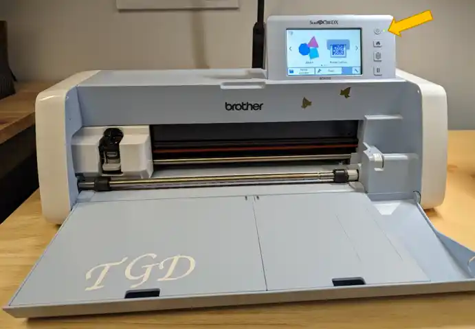

La découpeuse numérique Brother SDX225 est une machine qui vous permettra de réaliser plusieurs types de projets. Avec celle-ci, il est possible de tracer des motifs sur plusieurs supports différents (carton, vinyle, tissus, etc…). Il est également possible d’embosser et même dessiner!

## Guide de découpe papier cartonné et vinyle adhésif

### Logiciel Brother Canvas Workspace

**Télécharger** et **installer** le logiciel **Brother Canvas Workspace** si ce n'est pas encore fait

[Lien pour télécharger le logiciel](https://canvasworkspace.brother.com/fr) (disponible pour Windows et macOS)

**Lancer le logiciel** et se **connecter**. Si besoin se créer un **compte gratuit** à l'aide d'un courriel

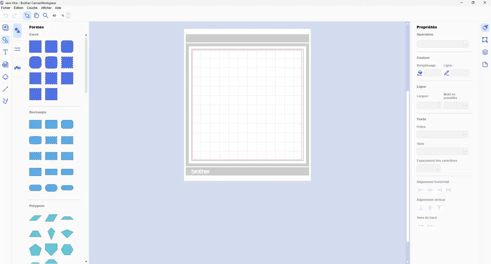

Enregistrer un modèle au format *png*, *jpg*, *gif*, *bmp* ou *svg*

Pour les modèles *png*, *jpg*, *gif*, ou *bmp* : cliquer sur l'icône **Traçage d'image**

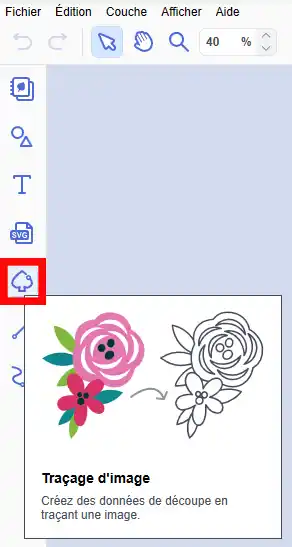

Pour les modèles *svg* : cliquer sur l'icône **SVG**

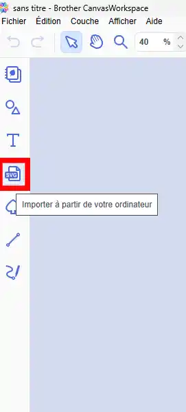

Pour dessiner directement des formes, des lettres ou des tracés (point par point ou main levée) :

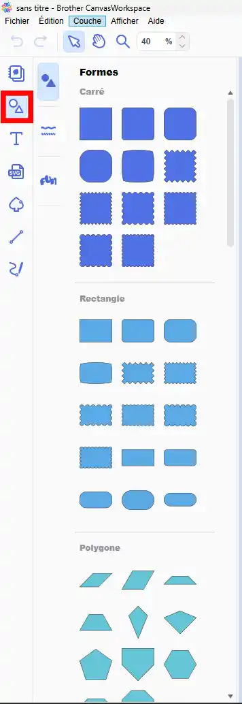

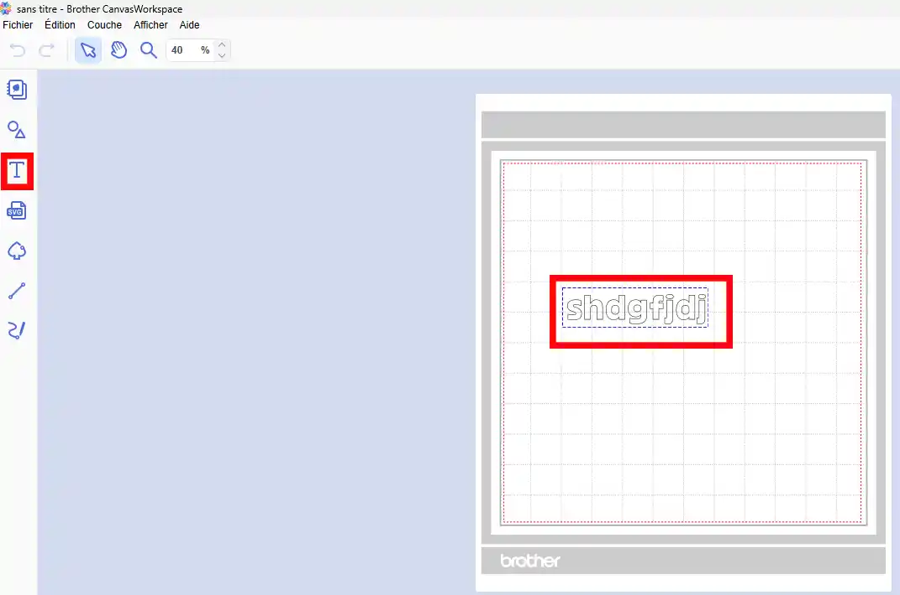

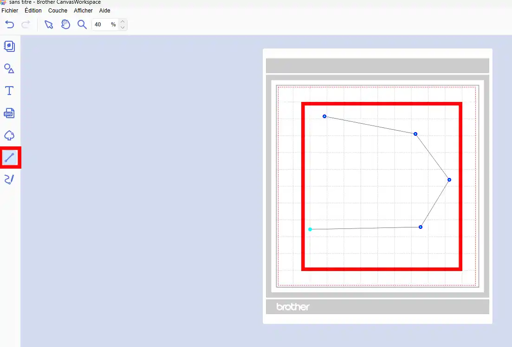

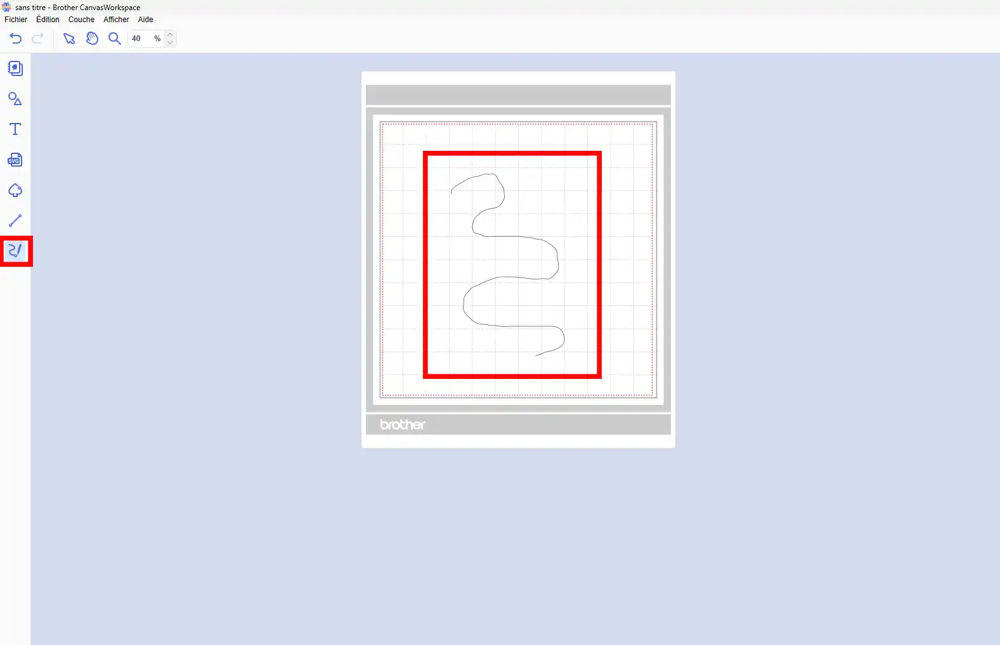

Pour exporter / transférer le fichier FCM vers la découpeuse :

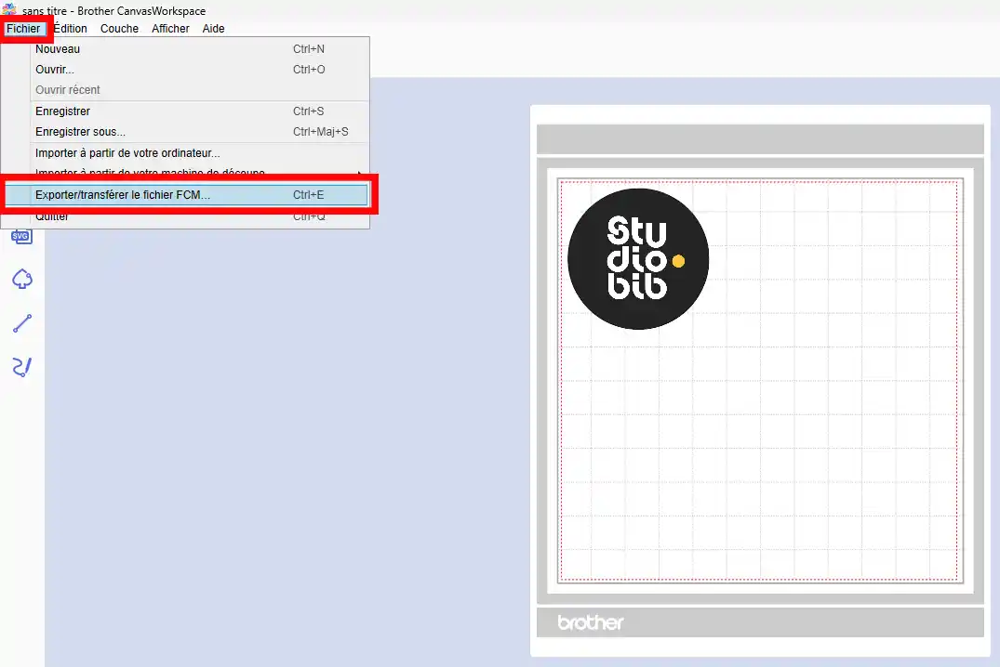

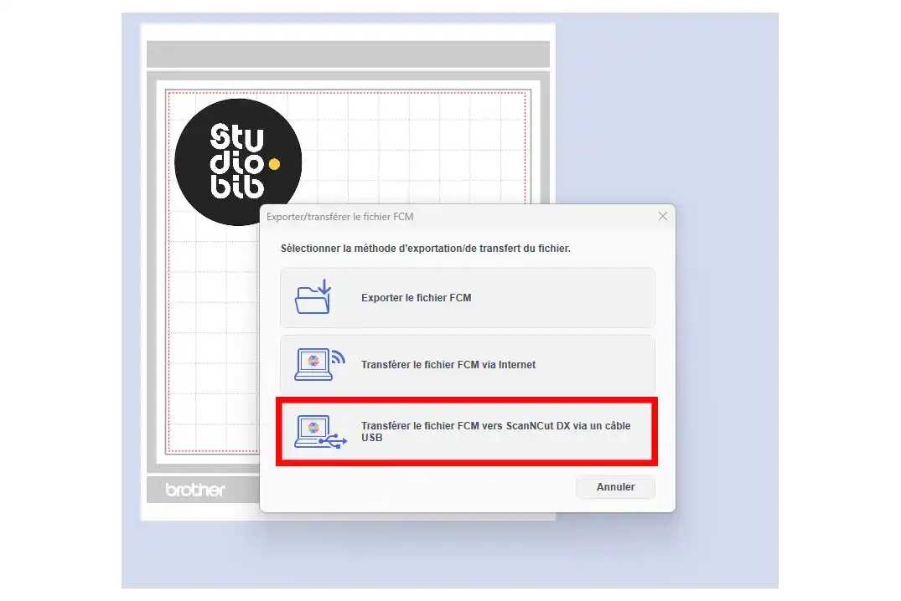

Pour récupérer le fichier transféré sur la découpeuse :

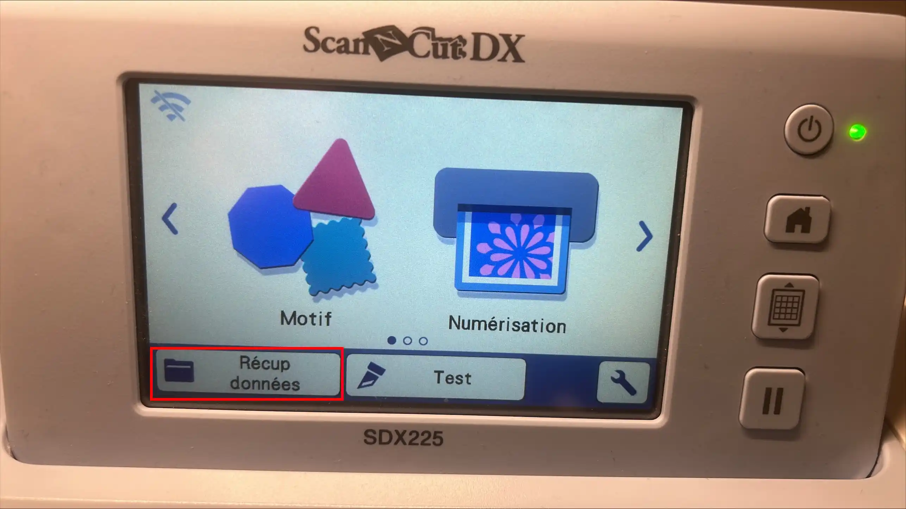

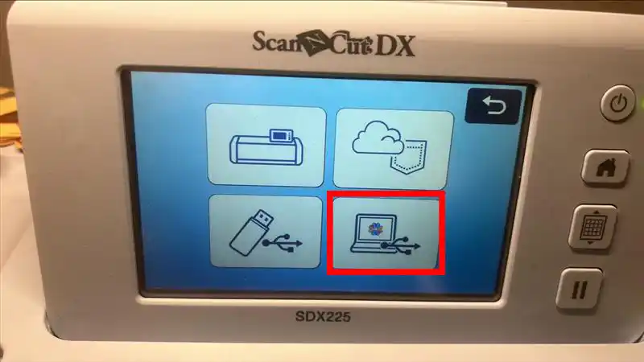

### Préparation de la machine

- Ouvrir le capot et appuyer sur le bouton pour allumer la machine.
- Préparer votre support adhésif (adhérence standard, faible adhérence ou embossage).

### Préparation du support adhésif

- Retirer le film protecteur transparent et le mettre de côté. Il est important de la remettre sur le support adhésif lorsque vous quitterez afin de préserver l’adhérence du support lors de son rangement.
- Déposer le papier cartonné ou la feuille de vinyle sur la partie adhésive du support et appuyer fermement afin de bien les fixer sur le support. Utiliser le rouleau pour éliminer les bulles d’air si nécessaire.

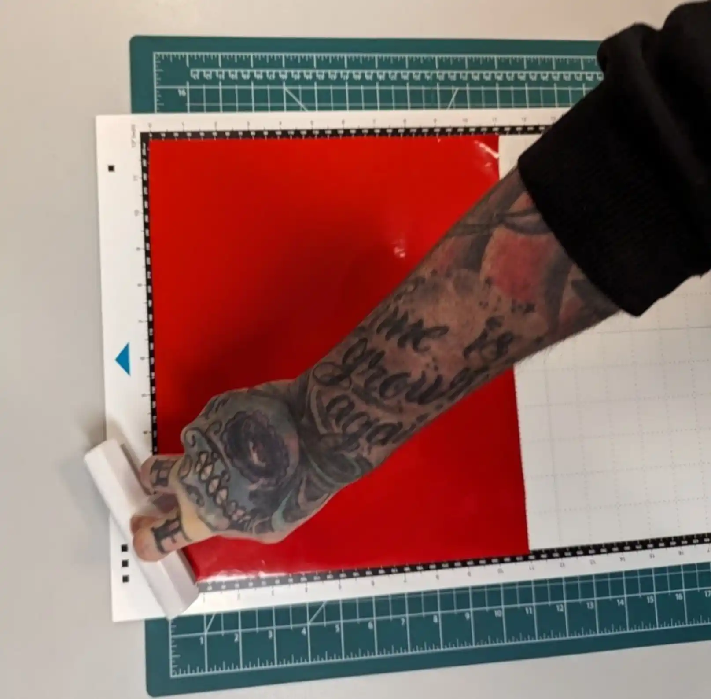

- Charger le support en vous assurant de l’insérer avec la flèche orientée vers le haut. Aligner le bord du support puis insérer-le sous les rouleaux d’entraînement.
- Appuyer ensuite sur le bouton d’entraînement et le support sera automatiquement ajusté vers la position adéquate.

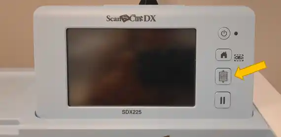

### Découpe d'un motif

- Cliquer sur l’icône écran d’accueil et ensuite sur **Motif**. 
- Choisir le modèle de votre choix à l’aide des flèches sur l’écran tactile.
- Redimensionner au besoin.

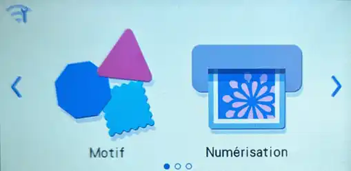
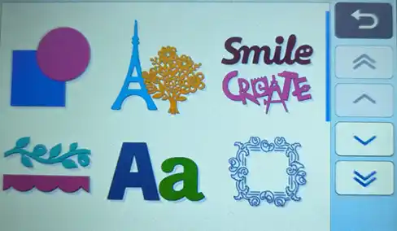

- Une fois redimensionner, appuyer sur **OK** ensuite sur le bouton **Placer**. Choisir l’emplacement sur la feuille de découpe où votre motif sera découpé. Veiller à le placer au même endroit que la feuille précédente sur le support adhésif. Appuyer ensuite sur **OK**.

:::alerte{type="succes" titre="Astuce"}
Laisser environ un centimètre de jeu à l’écran sur les côtés du support adhésif pour éviter de découper le support.
:::

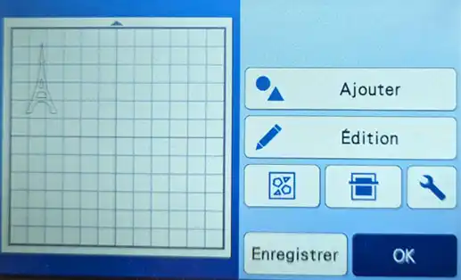

- Appuyer sur **Sélectionner**, puis sur **Découpe**. Une fois la découpe sélectionnée, cliquer sur la clé.
- Faire défiler vers le bas et activer l’option **Demi-coupe** en appuyant sur **ON**. Confirmer en appuyant sur **OK**. Cette opération permet à la lame de découper uniquement la première couche du matériel.

:::alerte{type="attention" titre="Attention"}
* Pour du vinyle : utiliser l’option **Demi-coupe**.
* Pour du papier cartonné : désactiver l’option **Demi-coupe**.
:::

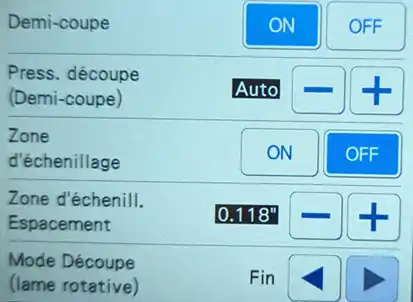

- Appuyer sur **Marche** pour découper le motif.
- Cliquer sur le bouton **Support adhésif** pour retirer le support adhésif.

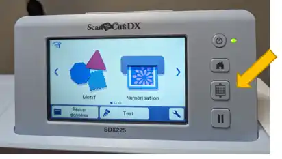

- S’installer sur une surface plane et découper un morceau de papier transfert à coller sur le motif. Coller ensuite le motif sur la surface de votre choix.

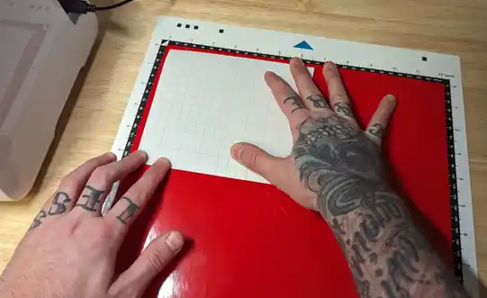
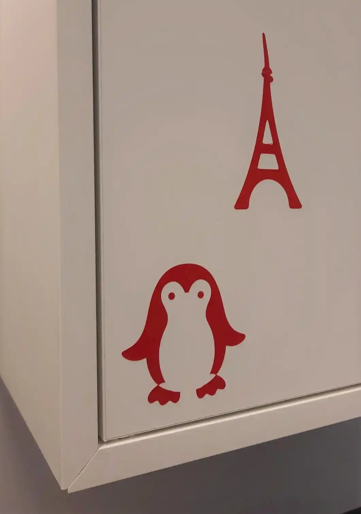
