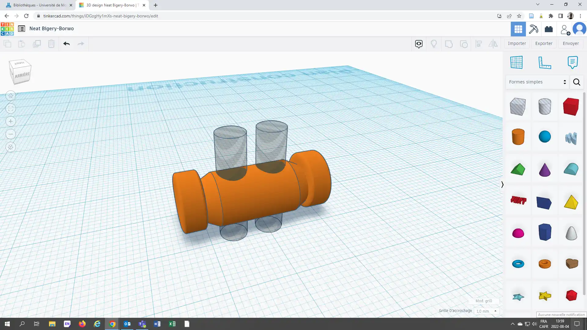
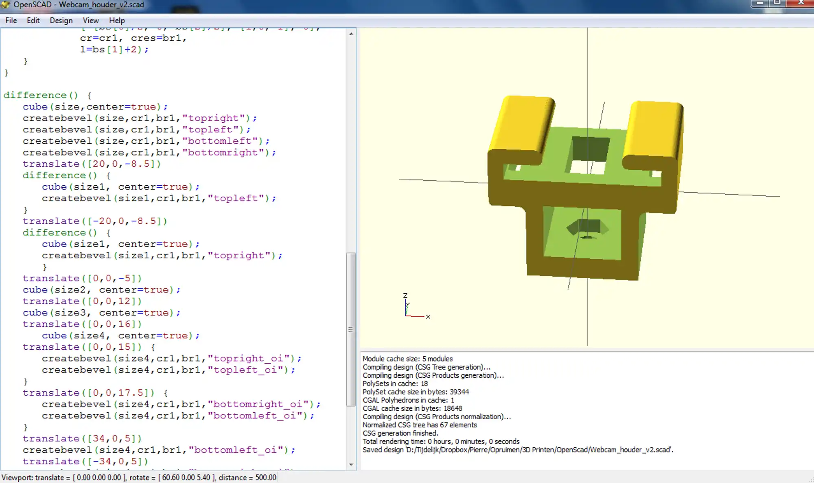
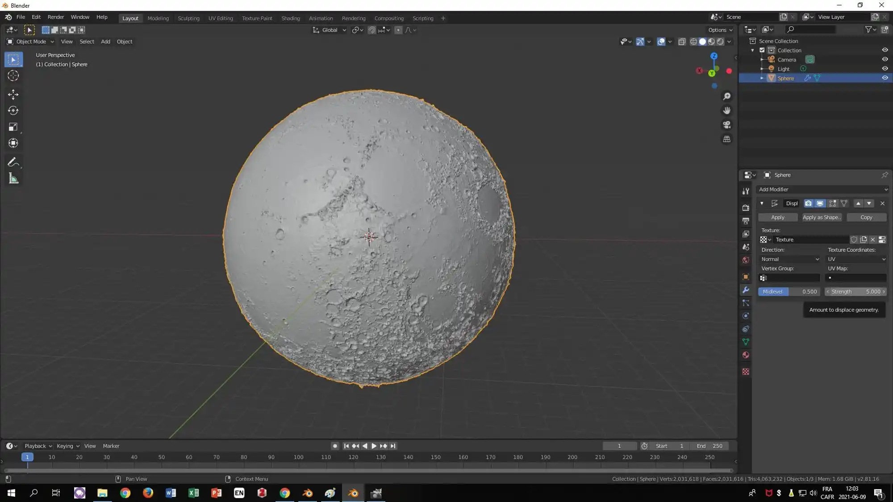
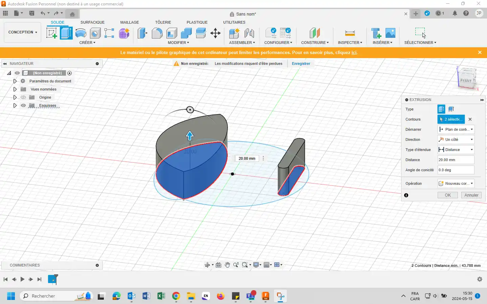

Ici, vous trouverez des logiciels pour concevoir vos propres créations, ainsi qu'une collection de ressources en ligne pour télécharger des modèles 3D prêts à imprimer.

::encart{nom="droit-auteur"}

## Logiciels de modélisation 3D

### Layering

- [Layering en ligne](https://layerling.com/)

Layering est une application sur navigateur gratuite et sans inscription, permettant de modéliser des objets très facilement. Pour les habitués de Tinkercad voici une version améliorée (choix du plateau correspondant à notre imprimante, fonction Hollow, pas de limite de taille du fichier à exporter...).

Cette application est la plus facile à prendre en main de cette liste

---

### Tinkercad

- [Tinkercad en ligne](https://www.tinkercad.com/)
- [Documentation](https://www.tinkercad.com/learn)

Tinkercad est une application sur navigateur développé par Autodesk, permettant de modéliser des objets très facilement. Tinkercad permet également de réaliser des montages électroniques ainsi que de programmer à l’aide de blocs.

Créez-vous un compte gratuitement et réalisez votre objet en combinant des formes géométriques de base.

---

### OpenSCAD

- [Télécharger OpenSCAD](https://www.openscad.org/)
- [Documentation](https://www.openscad.org/documentation.html)

**OpenSCAD** est un logiciel libre de modélisation paramétrique et compatible Windows, Linux et macOS. La conception des objets se fait grâce à un langage de programmation. Contrairement aux logiciels de modélisation comme Blender, il ne se concentre pas sur les aspects artistiques, mais plus sur les aspects de conception assistée par ordinateur, ou *Computer-aided design*.

::video[Impression et modélisation 3D]{integration="https://classe.iro.umontreal.ca/videos/embed/7967ad16-f87c-49ea-b5e6-519cb6e8a7bb"}

---

### Blender

- [Site officiel de Blender](https://www.blender.org/)
- [Documentation](https://docs.blender.org/manual/fr/latest/)

**Blender** est un logiciel de modélisation gratuit et ouvert (*open-source*). Il permet de modéliser, d’animer, faire des simulations, et de la composition d'image (*compositing*). Il est utilisé Il est utilisé dans les domaines du cinéma et du jeu vidéo.

Ce logiciel possède une grande communauté de pratique, on retrouve donc beaucoup de tutoriel sur internet.

---

### Fusion 360

- [Site officiel de Fusion 360](https://www.autodesk.com/ca-fr/products/fusion-360/overview?panel=buy\&term=1-YEAR\&tab=subscription\&plc=FSN)
- [Documentation](https://help.autodesk.com/view/fusion360/ENU/?guid=GUID-1C665B4D-7BF7-4FDF-98B0-AA7EE12B5AC2)

Ce logiciel de modélisation de la compagnie Autodesk existe en version payante et en version gratuite plus limitée. La version gratuite est amplement suffisante pour modéliser des objets en vu de l’impression 3D.

Fusion 360 est à privilégier pour modéliser des objets ayant des dimensions précises à respecter. Il permet de faire des formes géométriques plus ou moins complexes.

::video[Tutoriel vidéo : Modèles 3D]{youtube="Izh99EnGLGw"}

---

### SculptGL

- [SculptGL en ligne](https://stephaneginier.com/sculptgl/)
- [Documentation](https://stephaneginier.com/)

**SculptGL** est une application gratuite fonctionnant sur navigateur qui permet de modéliser avec une approche sculpture. Cela permet de modéliser des objets organiques en utilisant des outils pour ajouter ou enlever de la matière.

---

## Modèles en ligne

Trouver des modèles 3D prêts à être imprimés sur les sites suivants :

::tableau-donnees[Sites de modèles 3D]{source="/data/modeles3d.csv"}
