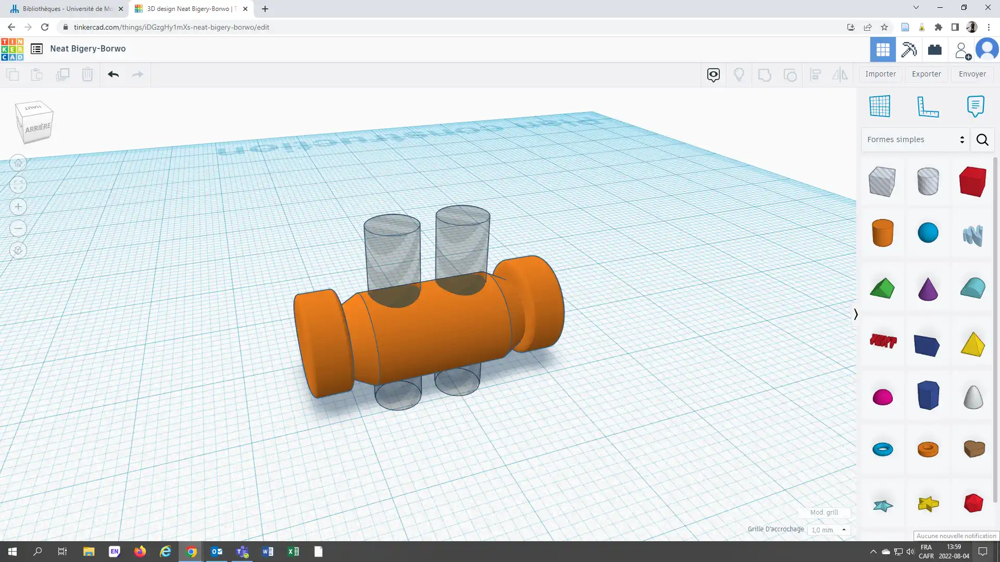
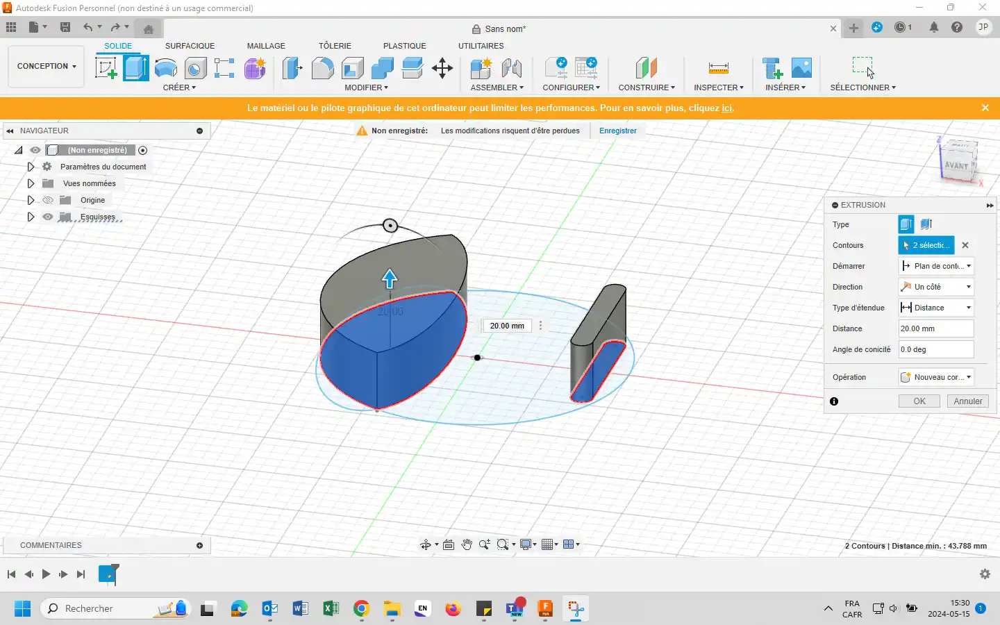
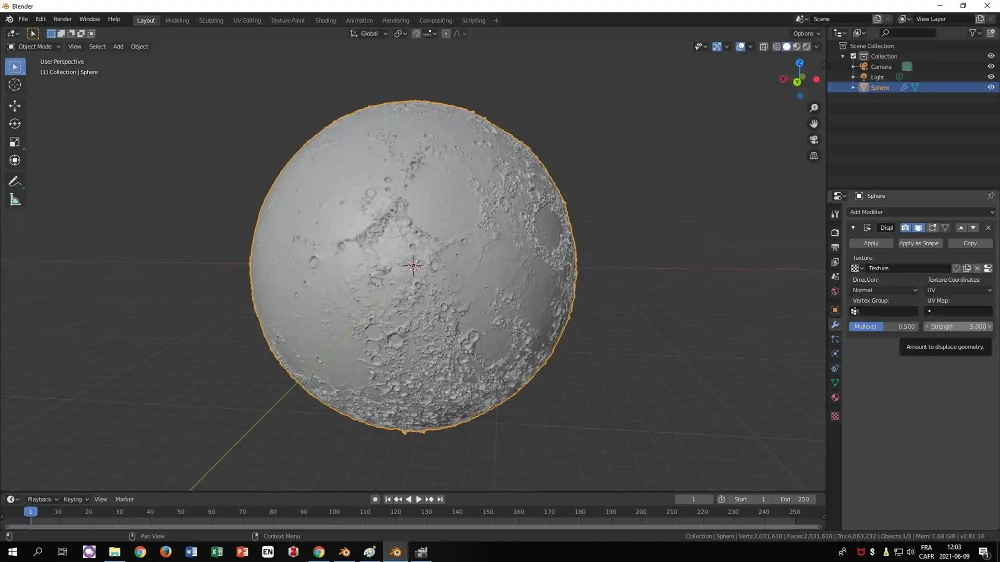
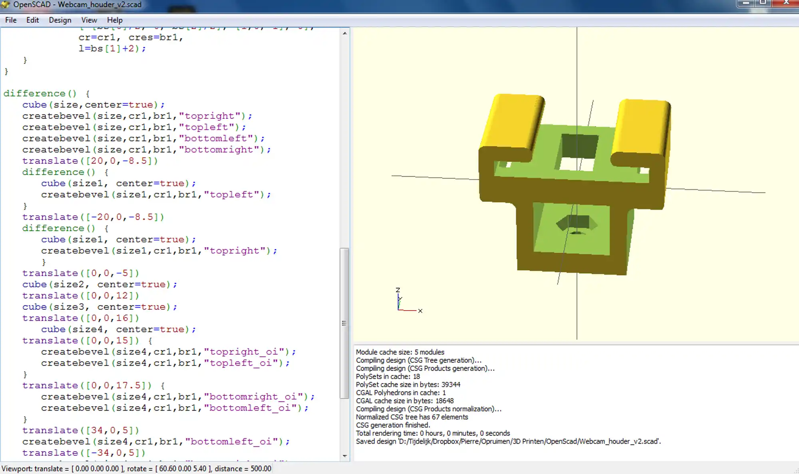

Comment concevoir vos propres créations? Où télécharger des modèles 3D prêts à imprimer?

::encart{nom="droit-auteur"}

## Modèles en ligne

Trouver des modèles 3D prêts à être imprimés sur les sites suivants :

::tableau-donnees[Sites de modèles 3D]{source="/data/modeles3d.csv"}

---

## Logiciels de modélisation 3D

### Layering

- [Layering en ligne](https://layerling.com/)

Recommander pour les **débutants**, et la **modélisation paramétrique**.

Layering est une application sur navigateur, gratuite et sans inscription, permettant de modéliser des objets très facilement. Pour les habitués de Tinkercad voici une version améliorée (choix du plateau correspondant à notre imprimante, fonction Hollow, pas de limite de taille du fichier à importer...).

Cette application est excellente pour découvrir la modélisation et réaliser ses premières créations. 

---

### Tinkercad

- [Tinkercad en ligne](https://www.tinkercad.com/)
- [Documentation](https://www.tinkercad.com/learn)

Recommander pour les **débutants**, et la **modélisation paramétrique**.

Tinkercad est une application sur navigateur développé par Autodesk, permettant de modéliser des objets très facilement. Tinkercad permet également de réaliser des montages électroniques ainsi que de programmer à l’aide de blocs.

Créez-vous un compte gratuitement et réalisez votre objet en combinant des formes géométriques de base.

---
### Shapr3D

- [Télécharger shapr3D](https://apps.microsoft.com/detail/9n4k9qfv4xfc?hl=fr-FR&gl=CA)
- [Documentation](https://www.shapr3d.com/)

Recommander pour **tous les niveaux**, et la **modélisation paramétrique**.

Quand Layering ou TinkerCAD ne vous suffit plus, essayez shapr3D. 

Utiliser votre adresse institutionnelle pour avoir accès à la version éducative.

Plutôt que de modéliser à partir de forme de base, shapr3D utilise les esquisses 2D auxquelles nous donnons du volume, ce qui permet de créer des formes plus complexes.

---

### Fusion 360

- [Site officiel de Fusion 360](https://www.autodesk.com/ca-fr/products/fusion-360/overview?panel=buy\&term=1-YEAR\&tab=subscription\&plc=FSN)
- [Documentation](https://help.autodesk.com/view/fusion360/ENU/?guid=GUID-1C665B4D-7BF7-4FDF-98B0-AA7EE12B5AC2)

Recommander pour les **initiés**, et la **modélisation paramétrique**.

Ce logiciel de modélisation de la compagnie Autodesk existe en version payante et en version gratuite plus limitée. La version gratuite est amplement suffisante pour modéliser des objets en vu de l’impression 3D.

Si shapr3D ne vous convient pas, essayez Fusion 360. Ce logiciel possède une grande communauté de pratique, on retrouve donc beaucoup de tutoriels sur internet.

::video[Tutoriel vidéo : Modèles 3D]{youtube="Izh99EnGLGw"}

---

### Blender

- [Site officiel de Blender](https://www.blender.org/)
- [Documentation](https://docs.blender.org/manual/fr/latest/)

Recommander pour les **initiés**, et la **modélisation organique**.

**Blender** est un logiciel de modélisation gratuit et ouvert (*open-source*). Il permet de modéliser, d’animer, faire des simulations, et de la composition d'image (*compositing*). Il est utilisé dans les domaines du cinéma et du jeu vidéo.

Ce logiciel possède une grande communauté de pratique, on retrouve donc beaucoup de tutoriels sur internet.

---

### OpenSCAD

- [Télécharger OpenSCAD](https://www.openscad.org/)
- [Documentation](https://www.openscad.org/documentation.html)

Recommander pour les **programmeurs**, et la **modélisation paramétrique**.

**OpenSCAD** est un logiciel libre de modélisation paramétrique et compatible Windows, Linux et macOS. La conception des objets se fait grâce à un langage de programmation. Contrairement aux logiciels de modélisation plus classique, il ne se concentre pas sur les aspects artistiques, mais plus sur les aspects de conception assistée par ordinateur, ou *Computer-aided design*.

::video[Impression et modélisation 3D]{integration="https://classe.iro.umontreal.ca/videos/embed/7967ad16-f87c-49ea-b5e6-519cb6e8a7bb"}

---

### SculptGL

- [SculptGL en ligne](https://stephaneginier.com/sculptgl/)
- [Documentation](https://stephaneginier.com/)

Recommander pour les **artistes**, et la **modélisation organique**.

**SculptGL** est une application gratuite fonctionnant sur navigateur qui permet de modéliser avec une approche sculpture. Cela permet de modéliser des objets organiques en utilisant des outils pour ajouter ou enlever de la matière comme si on travaillait de l'argile. Idéal pour les personnes ayant la fibre artistique et qui sont à l'aise avec les tablettes graphiques.

---

