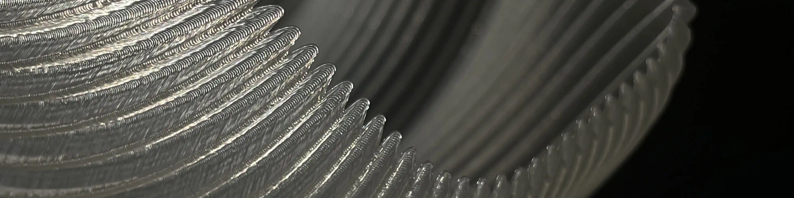
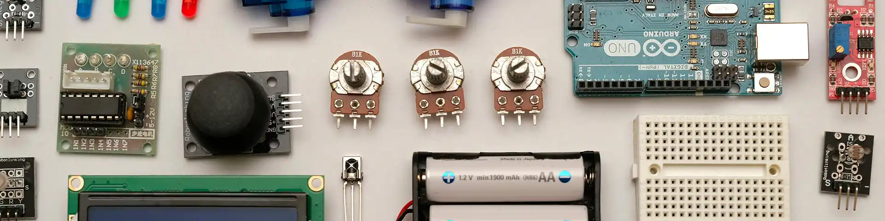
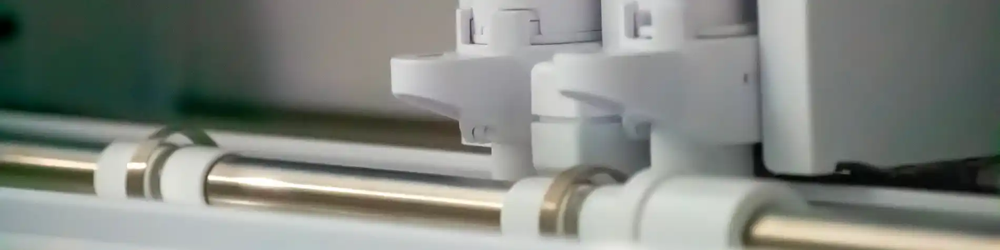
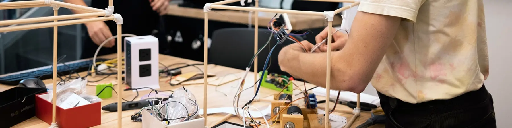
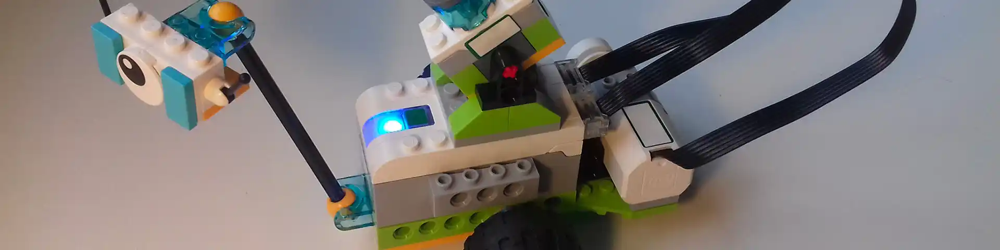
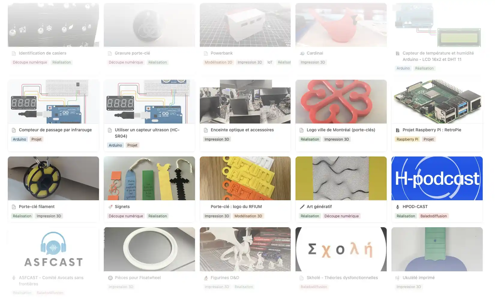

Les bibliothèques de l'Université de Montréal offrent à la communauté UdeM des équipements et du soutien en technologies créatives : impression 3D, réalité virtuelle, électronique, découpeuse, art textile et robots. Vous y trouverez aussi un répertoire de projets réalisés dans nos espaces.

:::cartes
-  [Impression 3D](/creatives/impression3d) Créez des objets en trois dimensions à partir de modèles numériques.
-  [Réalité virtuelle](/creatives/vr) Explorez des mondes virtuels et des expériences immersives.
-  [Électronique](/creatives/electronique) Apprenez à concevoir et à fabriquer des circuits électroniques.
-  [Découpeuse](/creatives/decoupeuse) Découpez des matériaux pour vos projets de création.
-  [Art textile](/creatives/art-textile) Créez des œuvres textiles avec nos équipements spécialisés.
-  [Robots](/creatives/robots) Empruntez ces accessoires didactiques.
-  [Projets](/creatives/projets) Découvrez les projets créatifs de la communauté UdeM
:::
