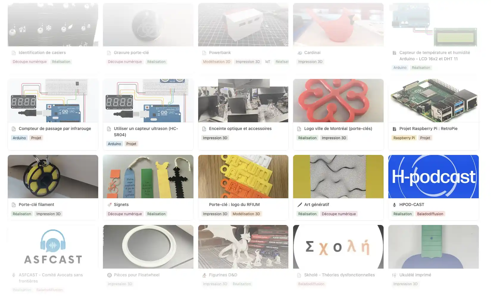

Découvrez les projets créatifs réalisés par la communauté UdeM dans nos espaces : impression 3D, électronique, objets connectés, balados et bien plus. Ce répertoire, hébergé sur Notion, rassemble des exemples concrets et inspirants issus des ateliers, cours et initiatives étudiantes.

::bouton[Consulter le répertoire des projets]{lien="https://studiobib.notion.site/projets"}

## Contribuer

Vous avez réalisé un projet dans nos espaces? Faites-le rayonner! Écrivez-nous à <studio@bib.umontreal.ca> avec les détails de votre projet.

::encart{nom="droit-auteur"}
