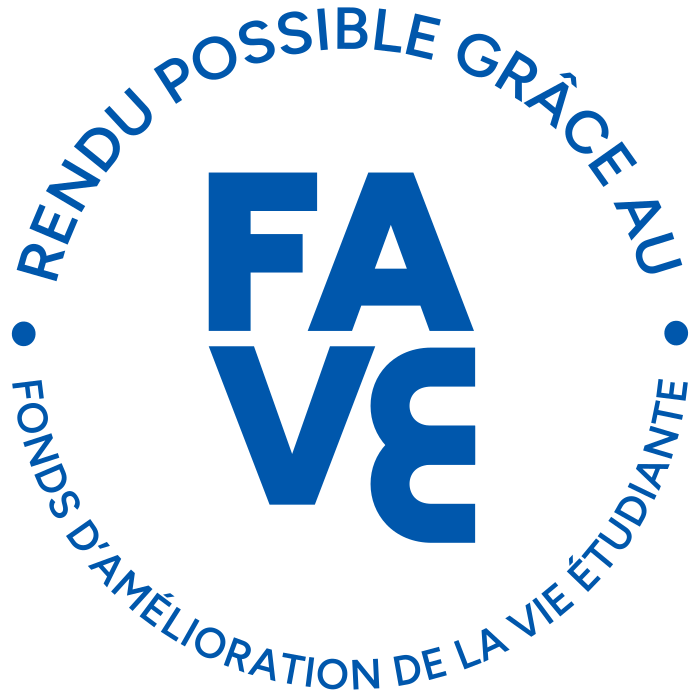

La table d’anatomie virtuelle Anatomage permet de visualiser l’anatomie humaine en trois dimensions, d’explorer des contenus liés au fonctionnement du corps et d’étudier des cas d’imagerie médicale. Elle soutient l’enseignement, l’apprentissage et la recherche dans plusieurs disciplines.

Grâce à des reconstructions numériques de cadavres humains, la table offre une expérience d’apprentissage interactive qui permet de manipuler des modèles anatomiques, d’observer les structures sous différents angles et d’explorer le corps humain de façon collaborative.

La salle peut accueillir des groupes d’environ 20 personnes pour des cours, des démonstrations, des activités pédagogiques ou des séances d’étude. Elle est également équipée de deux écrans muraux et de plusieurs modèles anatomiques en plastique.

---

:::lieu{titre="Bibliothèque de la santé" carte="https://maps.app.goo.gl/mNeCkNXevYShtAxD9"}
::adresse[Pavillon Roger-Gaudry]

::bouton[Demander une formation]{lien="https://umontreal.libwizard.com/f/anatomage"}

::bouton[Guide d'utilisation]{lien="/espaces/guide/anatomique" type="secondaire"}

Si vous avez des questions ou besoin d’aide, contactez-nous à <anatomage@bib.umontreal.ca>

:::

---

## Formation et accès

Pour utiliser la table de façon autonome, une formation d’initiation est recommandée. Cette courte séance présente les fonctions essentielles de la table, les règles d’utilisation de la salle et les bonnes pratiques à adopter.

Les personnes ayant terminé cette initiation pourront ensuite réserver la salle.

Vous pouvez également passer à la bibliothèque pour découvrir la table. Si la salle est libre, un membre du personnel pourra vous accompagner pour réserver un créneau sur place.

---

## Visite virtuelle

::pano360[Salle anatomique]{image="/img/pano/anatomique.webp" alt="Salle anatomique en vue 360°" legende="Vue en 360° de la salle anatomique"}

---

## Remerciements

La salle anatomique a été rendue possible grâce au Fonds d’amélioration de la vie étudiante (FAVE) et aux Frais d’amélioration des services technologiques et informatiques et des collections des bibliothèques (STIC), financés par les cotisations de la communauté étudiante.

:::logos
- 
:::
