## Écrans muraux

Les deux écrans dans la salle peuvent être utilisés pour projeter les deux moitiés de ce qui est affiché sur la table, ou l'un des deux peut être utilisé comme écran avec projection sans fil pour projeter un écran d'ordinateur.

<!-- [SCHÉMA À AJOUTER] -->

## Table anatomique

Un guide imprimé se trouve dans la salle pour l'utilisation des personnes qui la réservent. Voici quelques-unes des principales fonctionnalités.

### Gestes

Saisie tactile (dans le logiciel) :

:::legende
- :icone[number-circle-one] **Un doigt**
  - :icone[hand-swipe-right] **Glisser** Faire tourner
- :icone[number-circle-two] **Deux doigts**
  - :icone[arrows-out-cardinal] **Glisser** Déplacer
  - :icone[arrows-out-simple] **Écarter/resserrer les doigts** Zoomer/Dézoomer
  - :icone[arrow-clockwise] **Faire tourner** Régler la rotation (Rotation activée)
- :icone[number-circle-three] **Trois doigts**
  - :icone[arrows-down-up] **Glisser vers le haut/vers le bas** Ajuster le plan de coupe ou la coupe transversale en 2D
:::

### Navigation principale

:::legende{forme=panneau}
-  **Navigation** Rechercher dans les contenus disponibles de la table par thématique. Créer vos propres thématiques personnalisées.
-  **Prosection** Contient des modèles 3D annotés à partir d’images de dissections de cadavres réalisées par des professionnel(le)s.
- 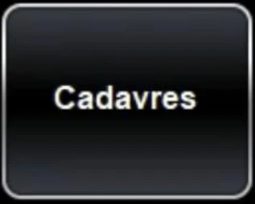 **Cadavres** Choisir parmi les ensembles de données d’anatomie humaine disponibles : six cadavres en corps entier, un corps synthétique et des données d’anatomie topographique haute résolution présentant des structures plus détaillées. La section multi-corps permet de comparer des régions anatomiques provenant de différents corps.
-  **Aide** Liens vers des documents d’instructions et des questions générales d’assistance (disponible en anglais seulement).
- 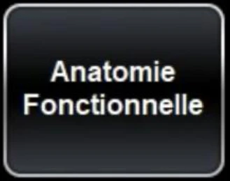 **Anatomie fonctionnelle** Consulter des contenus d’anatomie fonctionnelle tels qu’un cœur battant, des animations de mouvements articulaires, ainsi que des simulations de grossesse et d’accouchement.
- 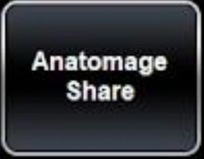 **Anatomage Share** Se connecter à son compte Anatomage Share pour transférer des fichiers depuis AnatomageShare.com et entre différents produits Anatomage.
-  **Catalogue de cas** Scans CT et IRM de patients et d’animaux, ainsi que des cadavres segmentés de primates non humains, de chiens et de chats. Rechercher des pathologies spécifiques et consulter des notes de cas détaillées.
- 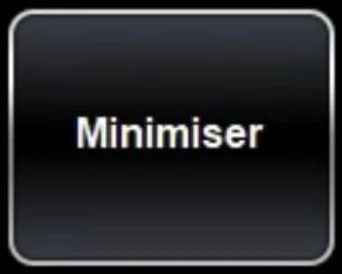 **Minimiser** Réduit l'application Table. Utiliser cette fonction pour réduire l’ensemble de données actuel et en ouvrir plusieurs autres simultanément.
-  **Histologie** Des centaines de lames d’histologie avec différents niveaux de grossissement et des annotations interactives.
-  **Ouvrir le fichier** Ouvrir les scans CT ou IRM non compressés du patient (fichiers DICOM) pour visualiser à la fois les coupes 2D et la reconstruction volumique 3D.
-  **Curriculum** Les scans de cadavres et de CT pré-annotés sont organisés par région et par système pour une intégration facile.
:::

### Contrôles universels

:::legende{forme=panneau}
- 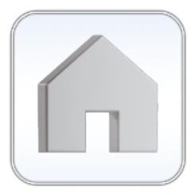 **Accueil** Ouvre le menu principal avec la barre d’application (Navigation, Cadavres, Anatomie fonctionnelle, Catalogue de cas, Histologie, Curriculum, Prosection, Anatomage Share, Ouvrir un fichier, Aide, Minimiser, Quitter l'application).
- 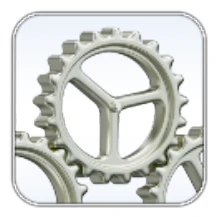 **Propriétés de l'application** Modifier les propriétés de l'application, telles que le déplacement des fonctions de la table vers le moniteur droit ou gauche, ou encore l'ajustement du texte et des couleurs d’arrière-plan.
:::

### Cadavres

:::legende
- 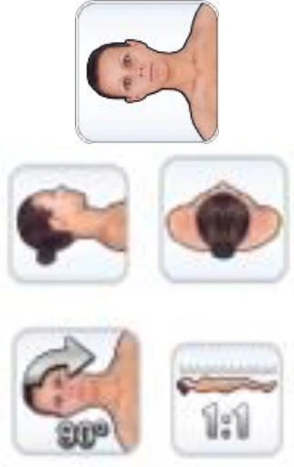 **Orientation du volume** Permet d’orienter le corps ou le volume selon le plan coronal, sagittal ou axial, ou de le faire pivoter de 90 degrés à chaque pression sur la touche. Sélectionner 1:1 pour afficher le corps ou le volume à sa taille réelle.
-  **Barres de défilement** Utiliser les barres de défilement pour activer et désactiver des groupes de structures sur le corps. La barre supérieure contrôle l'affichage de la majorité des structures. La barre inférieure contrôle l’affichage du système cardiovasculaire et des structures en arborescence.
- 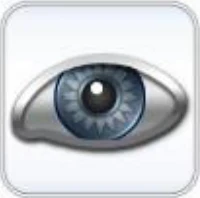 **Menu de visibilité** Activer et désactiver les systèmes, les structures, les annotations et les paramètres de visibilité.
  -  Afficher ou cacher toutes les structures du corps en même temps.
  -  Afficher l’annotation des structures.
  -  Annuler toutes les couleurs unies, transparences, repères osseux et origines et insertions pour tout le corps.
  -  **Menu de roue arc-en-ciel**
    - 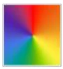 **Couleurs** Appliquer des couleurs aléatoires à toutes les structures d'une catégorie ou à toutes les catégories d'un système.
    - 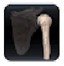 **Transparence** Rend une structure transparente. Ajuster le niveau de transparence avec les barres de défilement Surface et Volumique.
    - 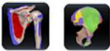 **Origines et insertions, repères osseux** *(sur les os uniquement)*.
- 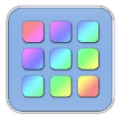 **Menu d’actions** Sélectionner une structure, puis sélectionner le menu d’actions (ou appuyer deux fois sur la structure) pour appliquer l’une des actions suivantes à la structure.
  -  Faire apparaître ou supprimer
  - 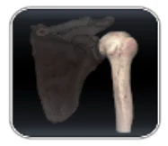 Mettre en transparence
  -  Appliquer une couleur unie spécifique à la structure
-  **Menu de l'outil d'exploration**
  - 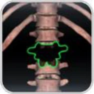 Utiliser l'outil de suppression pour supprimer des structures en appuyant dessus.
  -  Utiliser l'icône annuler pour remettre les structures supprimées.
  - 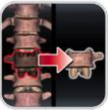 Sélectionner l’icône de l’outil de suppression d'écran partagé qui apparaît à droite pour afficher les structures supprimées lors de la scission de l’écran.
  - 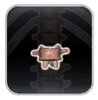 Isoler une structure avec l’icône isolement de structure. Taper plusieurs fois isolera la structure.
:::

## Ressources d'Anatomage

Anatomage offre des ressources d'apprentissage, telle que des capsules vidéo organisées dans des courts cours (disponibles en anglais seulement). Voici les étapes pour obtenir un accès à la plateforme d'apprentissage *Anatomage Training*.

1. Vous créez un compte pour *Anatomage Share* : [https://www.anatomageshare.com/signup](https://www.anatomageshare.com/signup)
2. Dans l'interface d'*Anatomage Share*, dans le coin supérieur à gauche, cliquez sur *Training Portal*, et faites une demande de compte *Training*. Vous devriez recevoir un courriel de confirmation dans un délai d'environ deux jours ouvrables.

Des cours de niveau débutant, intermédiaire et avancé sont disponibles pour vous aider à maîtriser les différentes fonctionnalités de la table Anatomage.
