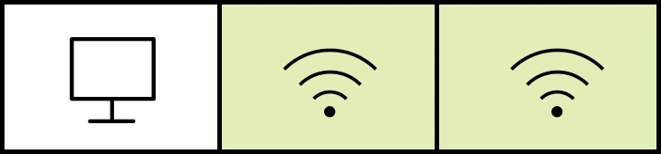
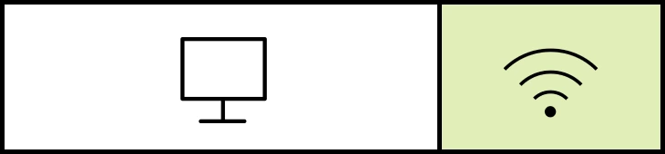
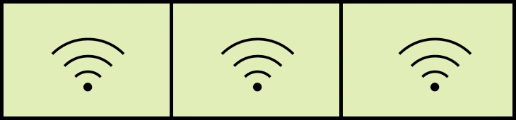
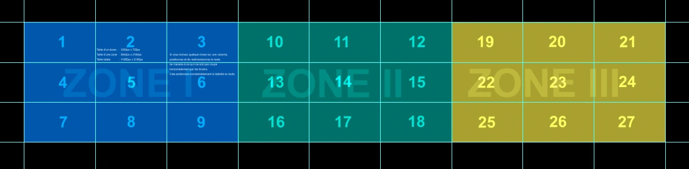

Le laboratoire de visualisation offre un environnement propice pour interagir avec des données visuelles. Le mur vidéo est composé de 27 écrans tactiles qui projettent le contenu du poste maître, ainsi que de 5 haut-parleurs. Le laboratoire permet également de connecter 3 périphériques externes.

La résolution totale des 27 écrans est de 11520x2160 pixels.

Chaque ensemble de 9 écrans fait 3840x2160 pixels (UHD).

## Les modes d'affichage {#modes-affichage}

Une borne tactile est disponible à l'entrée pour choisir un mode d'affichage.

### Mode #1

Le poste maître couvre les 27 écrans.

### Mode #2

Le mur vidéo se divise en 3 : le poste maître et 2 connexions sans fil.

### Mode #3

Le mur vidéo se divise en 2 : le poste maître sur le ⅔ et 1 connexion sans fil.

### Mode #4

Le mur vidéo se divise en 3, permettant à 3 périphériques de se connecter sans fil simultanément.

:::alerte{type="info" titre="Remarque"}
Seul le flux vidéo projeté par le poste maître est tactile.
:::

## Connexion sans fil

[Suivre la procédure suivante](/informatique/connexion-ecrans#procedure) pour connecter un périphérique sans fil au mur de visualisation.

## Son

Les 5 haut-parleurs émettent par défaut et simultanément le son de toutes les sources, aussi bien celui du poste maître que les périphériques branchés sans fil.

## Modèles {#modeles}

Des modèles sont disponibles pour vous aider à créer du contenu compatible avec la dimension du mur de visualisation. Les logiciels utilisés sont disponibles sur [les postes d'édition](/medias/postes-edition).

### Adobe Photoshop

[Télécharger le gabarit Photoshop (format .psd - 6 Mo)](/files/gabarit-lv.psd)

## Configuration de l'espace {#configuration-espace}

Le mobilier sur roulette permet d'agencer l'espace selon différentes configurations. La capacité d'accueil maximale est de 30 personnes.
