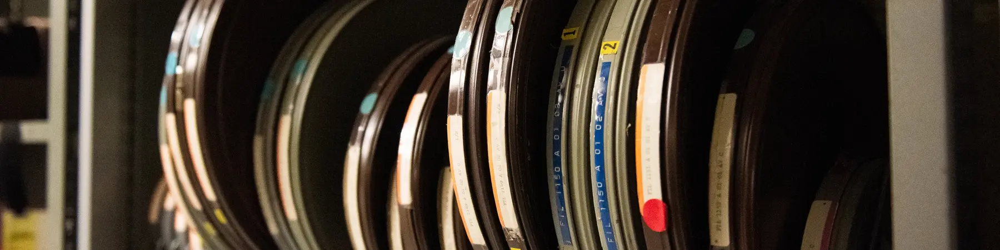
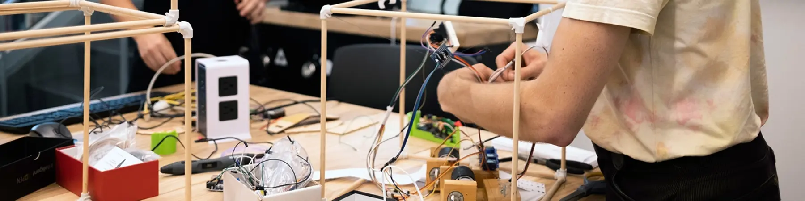
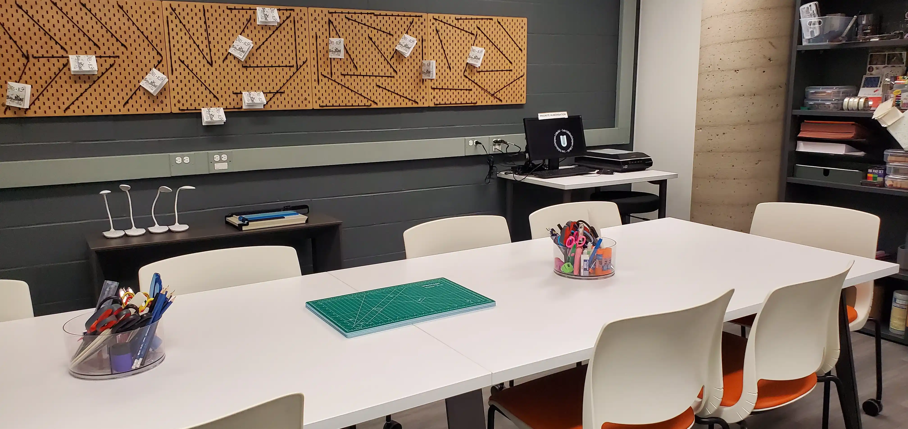
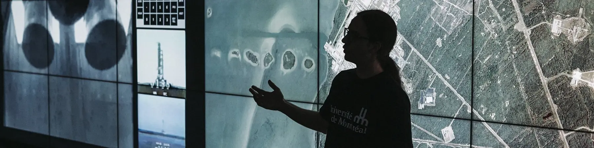
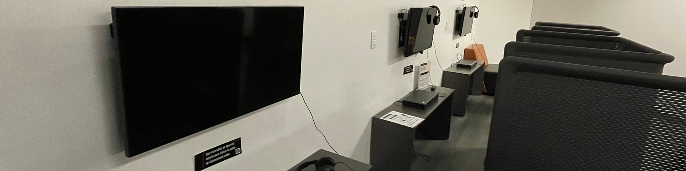
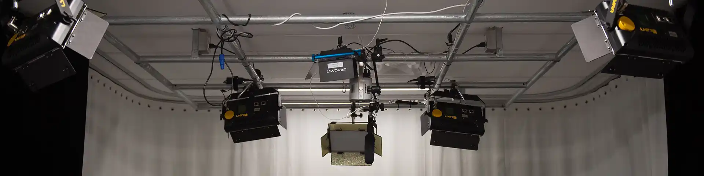

Les bibliothèques de l'UdeM offrent à leur communauté des espaces équipés pour la projection, la fabrication, la création de zines, la visualisation de données, le visionnement et l'enregistrement de balados et de vidéos.

:::cartes
-  [Amphithéâtre](/espaces/amphitheatre) Espace de projection équipé pour des visionnements de films, des conférences et des présentations.
-  [Ateliers de fabrication](/espaces/ateliers) Un espace pour s'initier à l'impression 3D, à l’électronique et à la fabrication numérique.
-  [Atelier de zines](/espaces/zines) Un lieu idéal pour concevoir ou finaliser un zine.
-  [Laboratoire de visualisation](/espaces/visualisation) Un environnement pour interagir avec des données visuelles sur grand écran.
-  [Salles de visionnement](/espaces/visionnement) Un espace confortable pour visionner des contenus multimédias.
-  [Studios balado](/espaces/studiosbalado) Des espaces pour l’enregistrement de balado
-  [Studios vidéo](/espaces/studiosvideo) Des espaces équipés pour filmer des vidéos facilement.
:::
