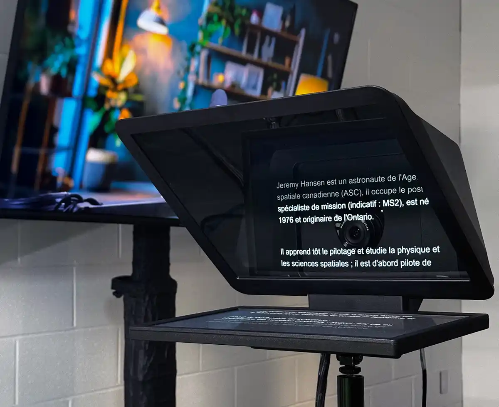

Le studio vidéo de la [Bibliothèque des lettres et sciences humaines](https://bib.umontreal.ca/espaces/#lsh) est conçu pour la captation vidéo individuelle, avec incrustation en temps réel, dans un environnement simple, autonome et accessible. Il permet de produire des présentations ou des interventions à l’image avec une qualité visuelle exceptionnelle, et intègre un prompteur facilitant une lecture fluide et naturelle à l’écran, sans nécessiter d’expertise technique préalable. Le studio est optimisé pour une utilisation par une seule personne.

---

::::lieu{titre="Bibliothèque des lettres et sciences humaines (BLSH)" carte="https://maps.app.goo.gl/cXprvQUPjBzQ6c8L8"}
::adresse[**Pavillon Samuel-Bronfman, 2e étage, local 2076-5&#x20;**]

À votre arrivée, présentez-vous au bureau de référence du 2e étage afin que le personnel vous déverrouille le studio.

:::parcours-reservation{reservation="https://calendrier.bib.umontreal.ca/space/21911" accompagnement="https://bookings.cloud.microsoft/book/studiobib@umontreal.ca/s/8H_NwNa_w0SuVTJV2MUyEw2?ismsaljsauthenabled" guide="/medias/guidevideolsh"}
Gardez votre réservation du studio. Sur place, le guide d’utilisation pas à pas vous accompagne, et le personnel du bureau de référence du 2e étage pourra vous aider à démarrer.
:::
::::

---

## Un studio clé en main pour vos enregistrements vidéo

Le studio est équipé d’un système intégré conçu pour faciliter la production de vidéos professionnelles en quelques étapes simples :

- **Interface unique** pour contrôler la caméra, l’incrustation et l’enregistrement.
- **Incrustation d’images en temps réel** en branchant simplement votre ordinateur au câble HDMI identifié.
- **Caméra haute définition** offrant une image nette, stable et de qualité professionnelle.
- **Prompteur intégré** permettant une lecture fluide et naturelle, tout en maintenant un contact visuel avec la caméra.
- **Éclairage optimisé** pour un rendu homogène et valorisant à l’écran.
- **Configuration pensée pour une utilisation autonome**, sans expertise technique préalable.

---

## Accès {#acces}

Seuls les membres de la communauté UdeM peuvent réserver le studio vidéo et accéder aux services de consultation et de soutien technique.

---

## Visite virtuelle

::pano360[Studio vidéo LSH]{image="/img/pano/studiovideolsh.webp" alt="Vue en 360° du Studio vidéo LSH" legende="Vue en 360° du Studio vidéo LSH"}

---

## Post-production

Les bibliothèques offrent des postes de montage vidéo pour finaliser vos productions. Consultez la section [Postes d'édition](/medias/postes-edition) pour plus d'informations.

---

Pour toute question ou demande particulière, n'hésitez pas à nous écrire à <studio@bib.umontreal.ca>

---
