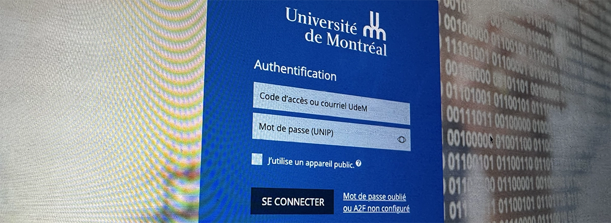
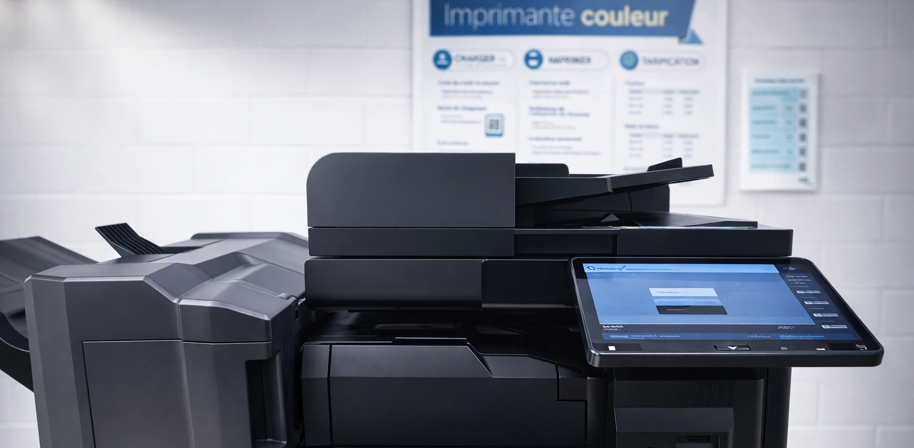
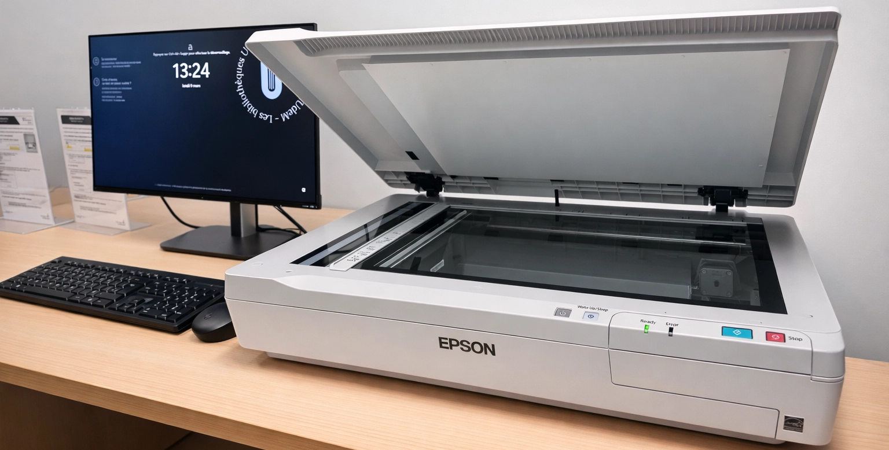
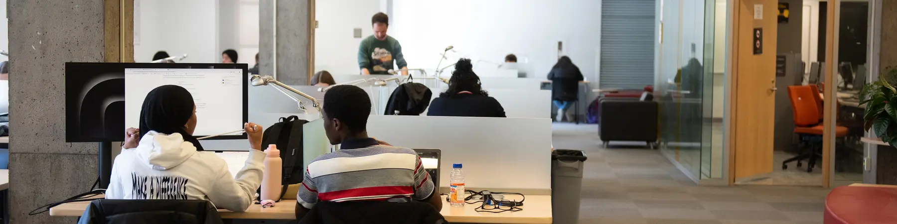
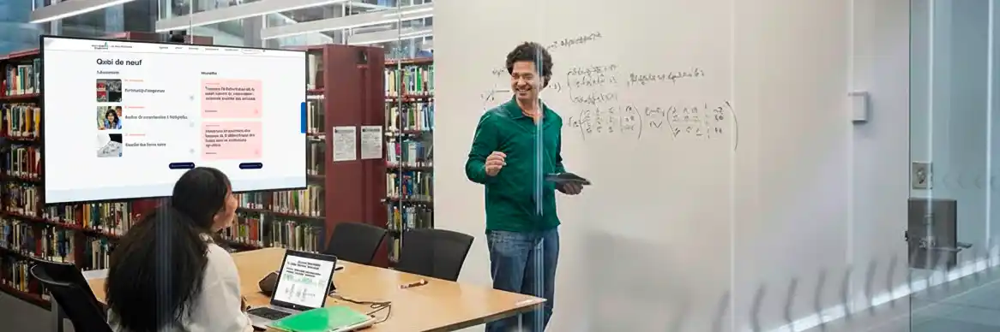
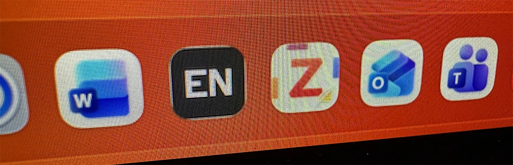

Les bibliothèques de l'Université de Montréal offrent à leur communauté des ressources informatiques : accès au réseau et aux ressources hors campus, impression, numérisation, ordinateurs et tablettes, logiciels et accessoires.

:::cartes
-  [Authentification](/informatique/authentification) Accédez aux services numériques avec votre identifiant institutionnel.
-  [Accès hors campus](/informatique/hors-campus) Utilisez le proxy pour accéder aux ressources à distance.
-  [Réseau sans fil](/informatique/reseau) Connectez-vous au Wi-Fi sécurisé du campus.
-  [Impression](/informatique/impression) Imprimez vos documents depuis les ordinateurs publics ou votre appareil.
-  [Numérisation](/informatique/numerisation) Scannez vos documents et envoyez-les directement par courriel.
-  [Ordinateurs](/informatique/ordinateurs) Utilisez les ordinateurs publics mis à disposition en bibliothèque.
-  [Postes AVA](/informatique/ava) Profitez d’écrans larges pour un confort de travail optimal avec votre appareil.
-  [Connexion sans fil aux écrans](/informatique/connexion-ecrans) Projetez le contenu de votre appareil sur les écrans sans fil disponibles.
-  [Tablettes iPad](/informatique/tablettes) Empruntez une tablette pour vos travaux et recherches.
-  [Logiciels](/informatique/logiciels) Retrouvez les logiciels disponibles sur nos ordinateurs publics.
-  [Accessoires](/informatique/accessoires) Empruntez chargeurs, adaptateurs, casques d'écoute et autres équipements.
:::

