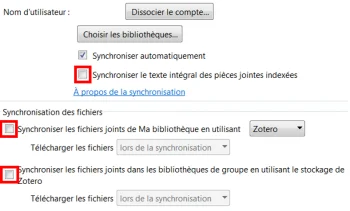

Zotero est un logiciel de gestion de références bibliographiques. Cette page présente son installation sur Windows et macOS ainsi que la configuration recommandée.

:::alerte{type="succes"}
Consulter [le guide d'utilisation de Zotero](https://boite-outils.bib.umontreal.ca/citer/zotero) dans la boîte à outils des bibliothèques.
:::

## Préalables

- Avoir ses [informations d'authentification](/informatique/authentification).
- Avoir une version à jour de [Microsoft Office 365](/informatique/logiciels/office).
- Important : **avoir redémarré son ordinateur et s’assurer de ne pas ouvrir Microsoft Word**.
- Si vous utilisez déjà Zotero sur votre ordinateur et que vous voulez installer une version plus récente, effectuez [une sauvegarde de vos bases de données](https://boite-outils.bib.umontreal.ca/citer/zotero?p=5362058) avant d’installer une autre version.

## Installation

:::::onglets{groupe="os-tabs"}
:::onglet[Windows]{valeur="windows"}
1. **Redémarrer votre ordinateur. Ne pas ouvrir Word.**
2. Aller à l’adresse [zotero.org/download](https://www.zotero.org/download/)
3. Installer l’application Zotero.
4. Installer le connecteur Zotero via votre navigateur Web (Firefox, Chrome, Edge).
:::

::::onglet[macOS]{valeur="macos"}
1. **Redémarrer votre ordinateur. Ne pas ouvrir Word.**
2. Aller à l’adresse [zotero.org/download](https://www.zotero.org/download/)
3. Installer l’application Zotero.
4. Installer le connecteur Zotero via votre navigateur Web (Safari, Firefox, Chrome, Edge).

:::alerte{type="info" titre="Pour les utilisateurs de Safari"}
Pour activer Zotero dans Safari, ouvrir Safari, aller dans le menu **Safari** → **Réglages** → **Extensions** → **Zotero Connector** et cocher **Activer**.
:::
::::
:::::

## Configuration recommandée

:::::onglets{groupe="os-tabs"}
::::onglet[Windows]{valeur="windows"}
### Sauvegarder dans l’infonuage de Zotero.

Dans Zotero, sous **Édition** → **Paramètres** → **Synchronisation**, cliquer sur **Créer un compte** et compléter le formulaire d’inscription. Valider le courriel de confirmation. Revenir dans Zotero sous **Édition** → **Paramètres**  → **Synchronisation** pour inscrire votre nom d’utilisateur et votre mot de passe et cliquer sur le bouton **Régler la synchronisation**.

:::alerte{type="info" titre="Note"}
Pour ne pas dépasser les 300 Mo d'espace infonuagique gratuit, il est fortement recommandé de **décocher** :

- L’option Synchroniser le texte intégral des pièces jointes indexées.
- Les deux options dans Synchronisation des fichiers.
:::

### Extension Zutilo

Il est recommandé d’installer l’extension Zutilo pour bénéficier de fonctionnalités supplémentaires. [Télécharger](https://github.com/wshanks/Zutilo/releases) sur votre ordinateur le fichier \*.xpi de l’extension, puis aller dans **Zotero → Outils → Extensions → Roue → Install Plugin From File** : choisir et ouvrir le fichier XPI. Parfois, il faut redémarrer Zotero (voir site Web LGB ci-dessous).

### Astuces

- **Si l’onglet Zotero ne s’est pas installé** dans Word ou LibreOffice :
  **Édition** → **Paramètres** → **Citer** → **Traitement de texte** → **Réinstaller** le module Word ou LibreOffice.

- **Pour ne pas sauvegarder de capture de page Web** pour chaque référence ajoutée :
  **Édition** → **Paramètres** → **Générales**, décocher l’option suivante `Faire une capture automatique de la page lors de la création de documents à partir de pages Web` et cliquer **OK**.
::::

::::onglet[macOS]{valeur="macos"}
### Sauvegarder dans l’infonuage de Zotero.

Dans Zotero, sous **Préférences** → **Synchronisation**, cliquer sur **Créer un compte** et compléter le formulaire d’inscription. Valider le courriel de confirmation. Revenir dans Zotero sous **Préférences** → **Synchronisation** pour inscrire votre nom d’utilisateur et votre mot de passe et cliquer sur le bouton **Régler la synchronisation**.

:::alerte{type="info" titre="Note"}
Pour ne pas dépasser les 300 Mo d'espace infonuagique gratuit, il est fortement recommandé de décocher :

- L’option Synchroniser le texte intégral des pièces jointes indexées.
- Les deux options dans Synchronisation des fichiers.
:::

### Extension Zutilo

Il est recommandé d’installer l’extension Zutilo pour bénéficier de fonctionnalités supplémentaires. [Télécharger](https://github.com/wshanks/Zutilo/releases) sur votre ordinateur le fichier \*.xpi de l’extension, puis aller dans **Zotero → Outils → Extensions → Roue → Install Plugin From File** : choisir et ouvrir le fichier XPI. Parfois, il faut redémarrer Zotero (voir site Web LGB ci-dessous).

### Astuces

- **Si l’onglet Zotero ne s’est pas installé** dans Word ou LibreOffice :
  **Préférences** → **Citer** → **Traitement de texte** → **Réinstaller** le module Word ou LibreOffice.

- **Pour ne pas sauvegarder de capture de page Web** pour chaque référence ajoutée :
  Dans Zotero, sous **Préférences** → **Générales**, décocher l’option suivante `Faire une capture automatique de la page lors de la création de documents à partir de pages Web` et cliquer **OK**.
::::
:::::
