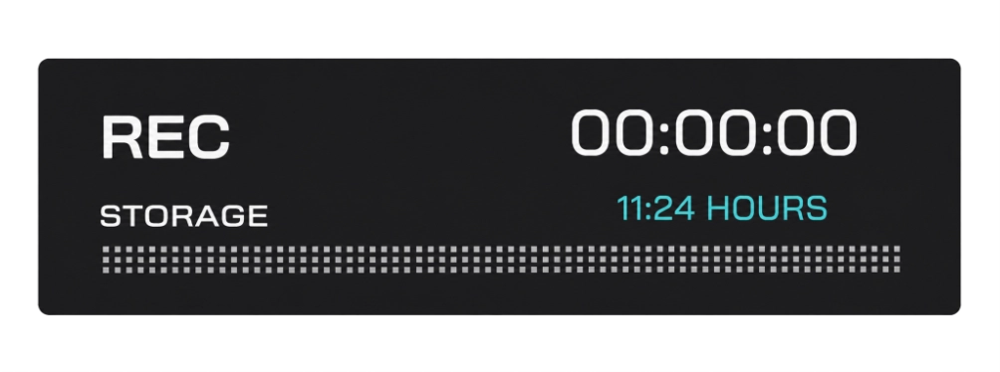
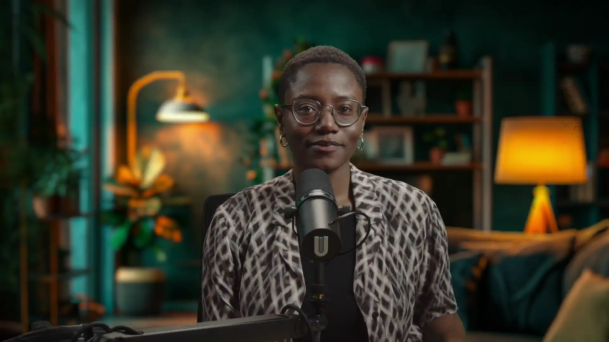
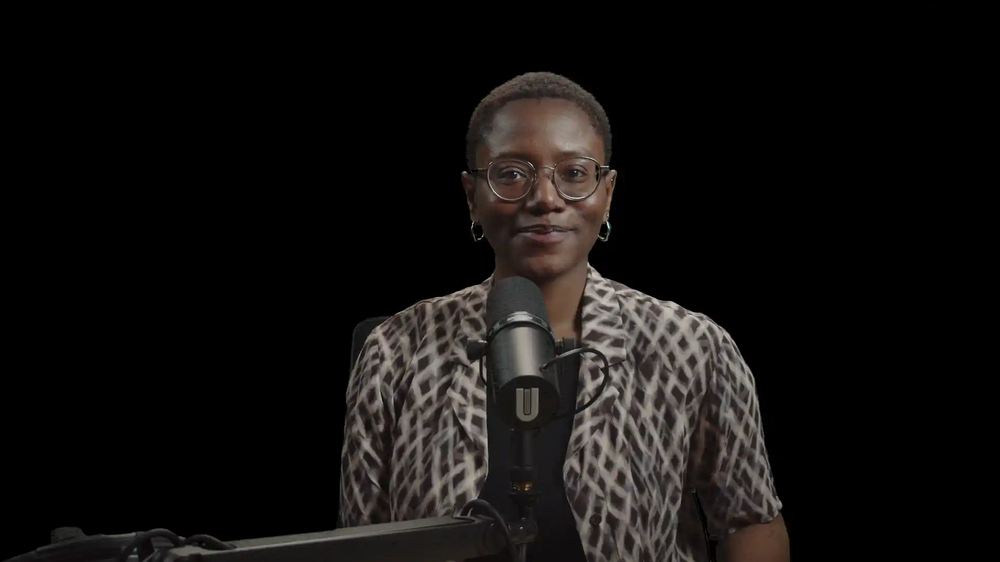
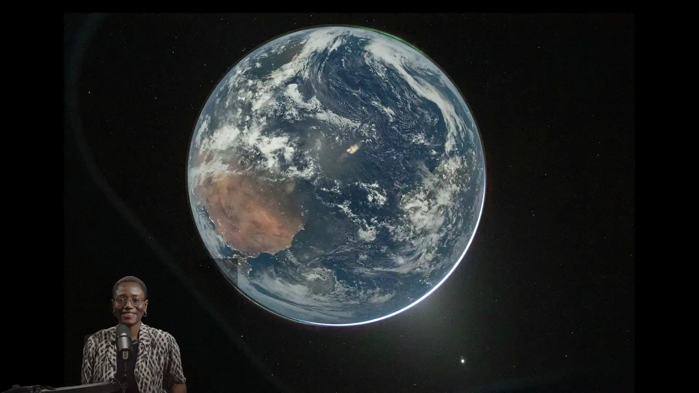
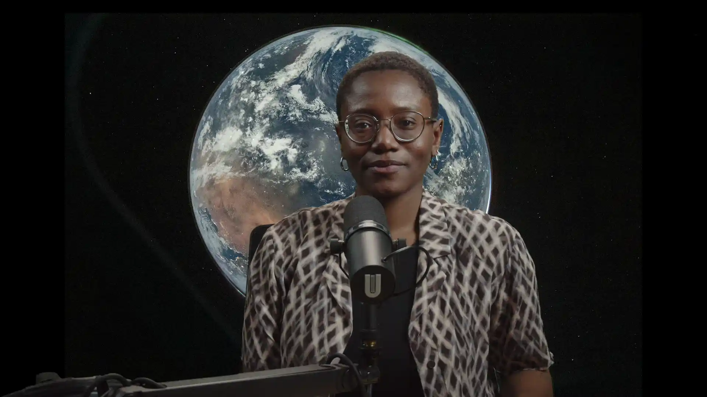
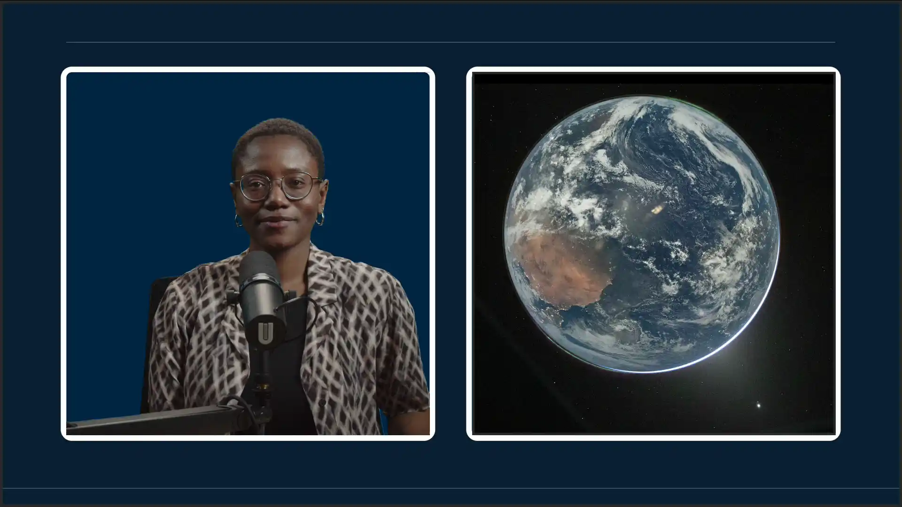
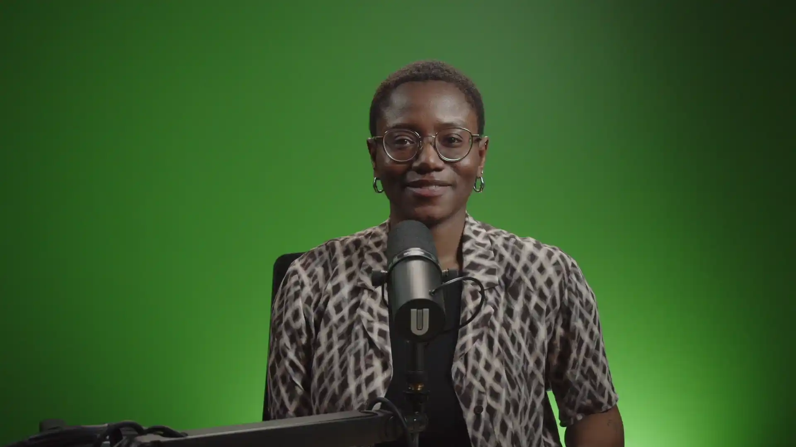

::bouton[Guide du téléprompteur]{lien="/medias/teleprompteur" type="secondaire"}

Ce guide explique comment utiliser le studio vidéo de la Bibliothèque des lettres et sciences humaines (BLSH) : préparer l'enregistrement, choisir un mode de présentation et récupérer vos fichiers.

## Avant l’enregistrement {#avant-enregistrement}

1. Brancher le disque dur au câble identifié **Enregistrement disque dur**.
2. Appuyer sur le bouton jaune  au centre de la console.
3. Les lumières et la caméra s’allumeront automatiquement. Éteindre l’éclairage ambiant (néons au plafond). 
4. L’écran de retour indiquera si le disque est bien inséré en affichant l’espace libre disponible.

5. Vérifier l’espace disque restant sur la console et l’écran. Si l’espace disponible est insuffisant pour la durée prévue de l'enregistrement, formater le disque dur avec votre ordinateur en **ExFAT** (voir la procédure en bas). 
6. Pour lancer l’enregistrement, appuyer sur le bouton **REC**.

:::alerte{type="succes" titre="Recommandation"}
Pour éviter tout problème technique, nous recommandons de privilégier un enregistrement continu plutôt que de multiplier les séquences.
Effectuez les coupes nécessaires au montage par la suite.
:::

:::accordeon
### Comment formater le disque dur?

Pour Windows :

1. Brancher le disque dur à votre ordinateur.
2. Localiser le disque dur dans l'explorateur de fichier.
3. Effectuer un clic droit dessus puis sélectionner **Formater**.
4. Dans **Système de fichiers**, choisir **ExFAT**.
5. Rebrancher le disque dur.

Pour macOS :

1. Brancher le disque dur à votre ordinateur.
2. Ouvrir l'application **Utilitaire de disque**.
3. Sélectionner le disque dur dans la liste à gauche.
4. Cliquer sur **Effacer** en haut de la fenêtre.
5. Dans **Système de fichiers**, choisir **ExFAT**.
6. Rebrancher le disque dur.
:::

---

## Positionnement dans le studio

La caméra du studio est fixe et préréglée. **Merci de ne pas la déplacer, ni la manipuler physiquement**.

Recommandations pour un bon cadrage :

- Utiliser l’écran de retour vidéo pour vérifier votre position à l’image;
- Ajuster votre siège ou vous repositionner pour ajuster votre position à l'écran, plutôt que de déplacer la caméra.

---

## Choisir un mode de présentation

Le studio propose différents modes de présentations. Vous pouvez en choisir en appuyant sur le bouton **Fonds** de la console de contrôle.
À noter que les modes **C**, **D** et **E** nécessitent de brancher votre ordinateur au câble HDMI identifié pour fonctionner correctement.

:::alerte{type="attention" titre="Attention"}
Il est recommandé de porter des vêtements de couleurs différentes du vert pour éviter les problèmes d’incrustation.
:::

::::onglets
:::onglet[Fond virtuel]{valeur="A"}
### Le fond virtuel (Bouton A)

:::

:::onglet[Fond noir]{valeur="B"}
### Le fond noir (Bouton B)

:::

:::onglet[Présentation]{valeur="C"}
### Le mode présentation (Bouton C)

Fonctionne en branchant votre ordinateur au câble HDMI identifié : vous êtes alors incrusté à l’image, superposé au contenu affiché sur votre ordinateur.

:::

:::onglet[Personnalisé]{valeur="D"}
### Le mode personnalisé (Bouton D)

Fonctionne en branchant votre ordinateur au câble HDMI identifié : votre image est alors au premier plan, avec le contenu affiché à l’écran en arrière-plan.

:::

:::onglet[Entretien]{valeur="E"}
### Le mode entretien (Bouton E)

Fonctionne en branchant votre ordinateur au câble HDMI identifié : vous apparaissez à l’écran aux côtés de votre interlocuteur à distance.

:::

::::

<!-- Mode fond vert retiré temporairement : pour le rétablir, remettre ce volet
     juste avant le « :::: » qui ferme les onglets ci-dessus.
:::onglet[Fond vert]{valeur="fond-vert"}
### Le mode fond vert

Permet une incrustation en post-production.

:::
-->

---

## Entretien à distance - visioconférence {#entretien-distance}

Pour réaliser un entretien via un logiciel de visioconférence (ex. Zoom, Teams) :

1. Brancher le câble HDMI (identifié) à votre ordinateur.
2. Dans les paramètres audio de votre application, sélectionner RØDECaster ou RODE RCV comme entrée et sortie audio.
3. L’image de votre ordinateur s’affichera automatiquement à l’écran du studio. Choisir le mode **Entretien** (Bouton E) pour apparaître à l’écran aux côtés de votre interlocuteur à distance.

---

## Terminer l'enregistrement {#terminer-enregistrement}

1. Appuyer sur le bouton **STOP** pour arrêter l’enregistrement.
2. Débrancher le disque dur et le brancher en utilisant le câble **transfert** sur votre ordinateur pour transférer les fichiers.

:::alerte{type="attention" titre="Attention"}
- Assurez-vous d’avoir suffisamment d’espace disponible selon la durée de l’enregistrement.
- Faites une copie de sauvegarde dans votre espace infonuagique ou une 2ème copie dans un autre périphérique.
:::

---

## Fin de session

- Appuyer sur le bouton jaune **Fermer** pour éteindre le système.

---

Crédit photo : « [Hello, World](https://www.flickr.com/photos/nasa2explore/55185633398) » par [NASA Johnson](https://www.flickr.com/photos/nasa2explore/), [CC BY-NC-ND 4.0](https://creativecommons.org/licenses/by-nc-nd/4.0/deed.fr)
