Le studio vidéo de la Bibliothèque Thérèse-Gouin-Décarie (TGD) permet de créer en toute simplicité des vidéos dans un espace spécifiquement aménagé. Vous aurez seulement besoin d'une clé USB. C'est l'endroit idéal pour pratiquer une présentation orale, créer des capsules de formation, ajouter du contenu vidéo dans un travail ou réaliser une présentation par affiche avec incrustation d’images!

---

## Instructions

1. Insérer une clé USB dans le module noir. Les disques externes ne sont pas supportés.
2. Le système se déclenchera au bout de quelques secondes.
3. Sélectionner la source désirée.
4. Au besoin, placer le mobilier (écran mobile, tableau lumineux, etc) selon les pictogrammes au sol.

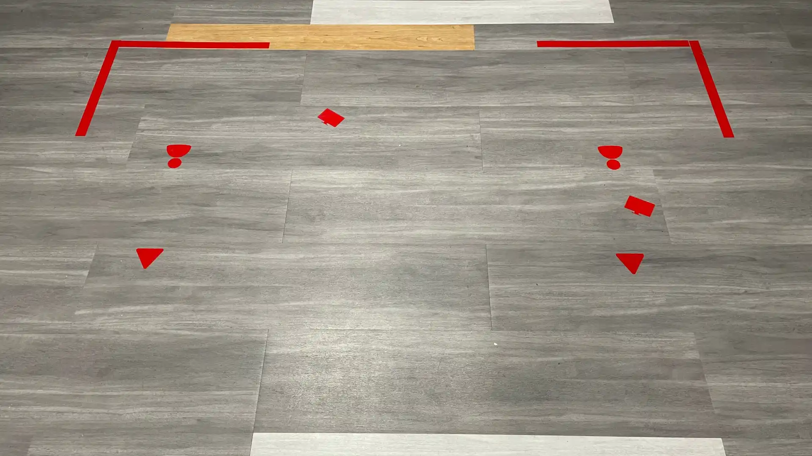

5. Appuyer sur le bouton **Record** du module.
6. Pour arrêter l'enregistrement, appuyer sur **STOP**.
7. Laisser du temps au module pour faire le transfert sur la clé USB. La clé peut être retirée lorsque la lumière verte ne clignote plus.
8. Le cadrage de la caméra est présélectionné. Il est possible d’utiliser le zoom.

:::alerte{type="succes" titre="Votre clé USB ne démarre pas le studio?"}
Vous devez alors formater votre clé (n'oubliez pas de sauvegarder vos données d'abord!).

**Étapes :**

1. Vérifier que la clé est de 32 Go ou moins et formatée en FAT32.
2. Brancher la clé à un ordinateur.
3. Lancer l'explorateur de fichiers.
4. Cliquer sur **Ce PC**.
5. Faire un clic droit sur la clé USB et sélectionner **Formater**.
6. Choisir **FAT32** comme système de fichiers.
7. Cliquer sur **Démarrer**, puis confirmer avec **OK**.
8. Éjecter la clé en toute sécurité.

**Besoin d'une clé USB?** Vous pouvez emprunter une clé de 16 Go pour 6 heures au comptoir de la bibliothèque.
:::

---

## Les différents modes de présentation

:::alerte{type="attention"}
Attention, pour changer entre les caméras 1-2-3 et la caméra 4 : il faut choisir la bonne caméra en sélectionnant la bonne source au mur + passer du mode 1 à 2 sur le boitier switch qui se trouve dans la porte milieu du meuble, étage du haut, en fonction de la source souhaitée...
:::

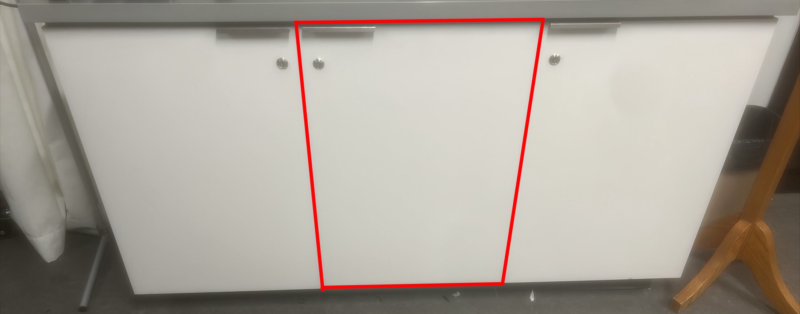

Input 1 = Caméra 4; Input 2 = Caméras 1 à 3

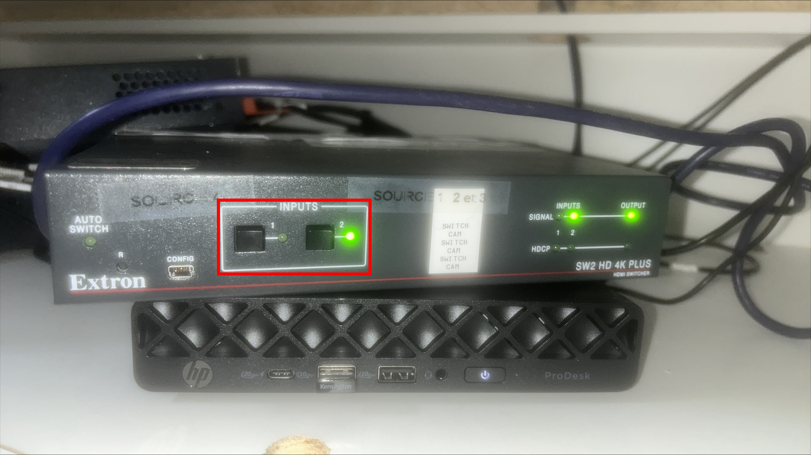

4 différents modes d’enregistrement sont disponibles pour créer votre vidéo. Le panneau de sélection des 4 sources se trouve au mur.

:::::onglets
:::onglet[Présentation standard]{valeur="A"}
### Présentation standard (Source 1)

#### Avec écran mobile

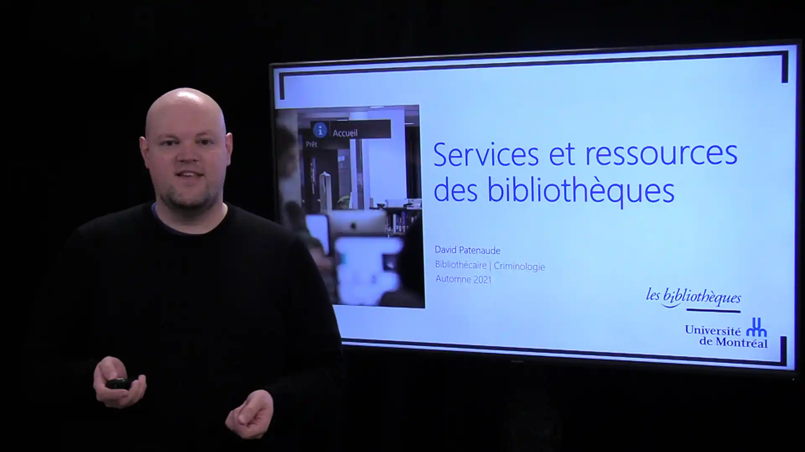

#### Recommandations pour les projections sur le grand écran :

- Utiliser une police de caractère de 44
- Placer l’information pertinente à droite
- Préférer des mots-clés
- Utiliser un fond d’écran clair

#### Sans écran mobile

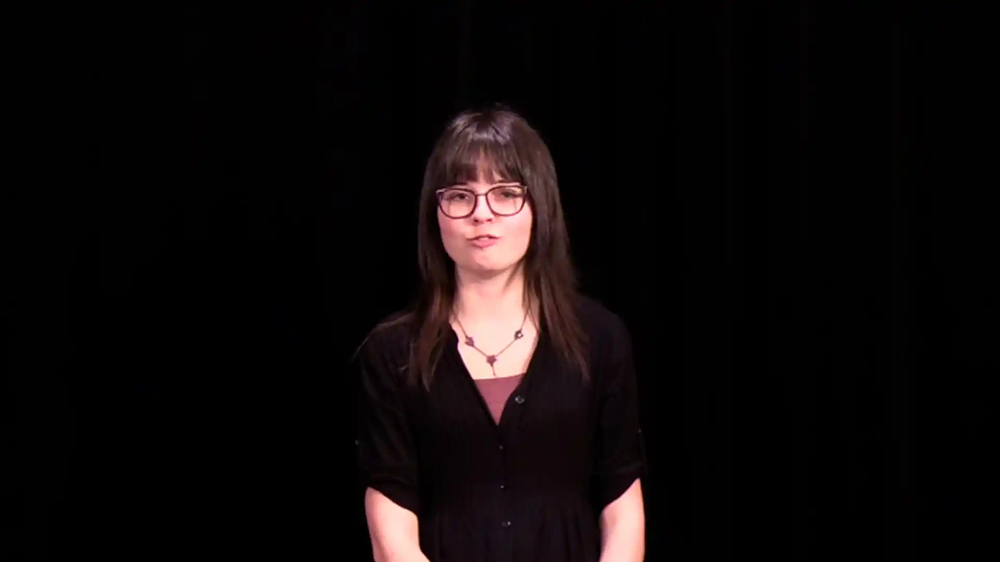

:::

::::onglet[Tableau lumineux]{valeur="B"}
### Tableau lumineux (Source 2)

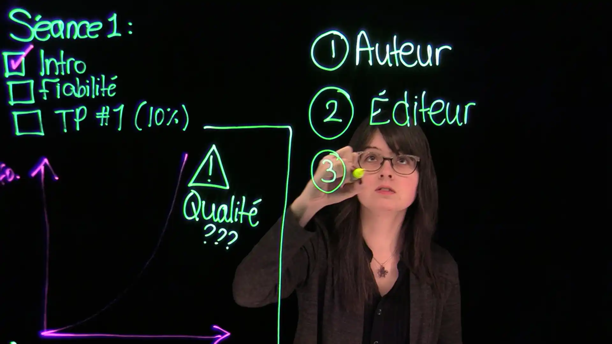

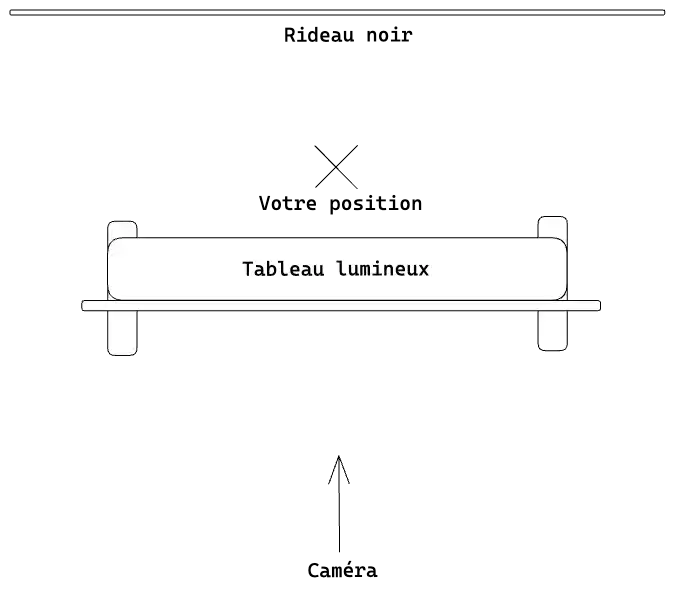

- Une inversion d’image est nécessaire en postproduction, grâce aux logiciels de montage Adobe Premiere Pro ou DaVinci Resolve.

:::alerte{type="info"}
N'oubliez pas de brancher la prise électrique du tableau et de suivre les instructions indiquées sur le tableau pour l'allumer. Après l’utilisation, assurez-vous de bien nettoyer le tableau en suivant ces étapes.
:::

1. Vaporiser toute la surface avec le produit prévu à cet effet.
2. Utiliser la raclette pour essuyer le produit. L'écriture devrait être majoritairement retirée à cette étape.
3. Vaporiser une mince couche d'eau.
4. Avec la lingette sèche, essuyer toutes les particules.

::video[Tutoriel vidéo : Guide du studio vidéo TGD (Tableau lumineux)]{youtube="NFxWiwcch58"}
::::

:::onglet[Fond vert]{valeur="C"}
### Le mode fond vert (Source 3)

Permet une incrustation en post-production.

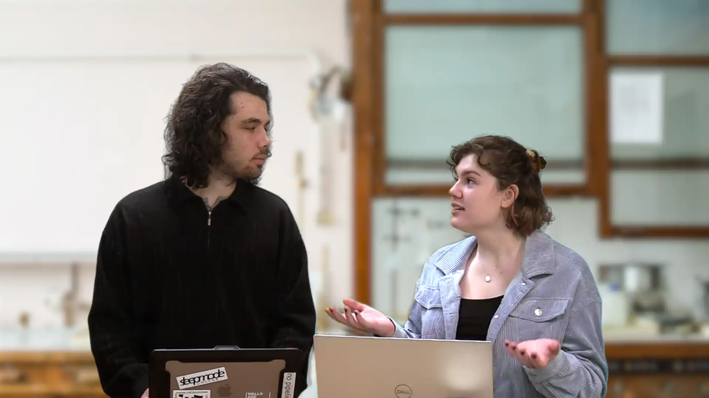

- Ne porter aucun vêtement vert.
- Utiliser une image de fond neutre ou générale.
- Tirer le rideau noir pour faire place au mur vert (à la Bibliothèque Thérèse-Gouin-Décarie) ou au rideau métallique (Bibliothèque des lettres et sciences humaines).
:::

:::onglet[Vue de haut]{valeur="D"}
### Le mode vue de haut (Source 4)

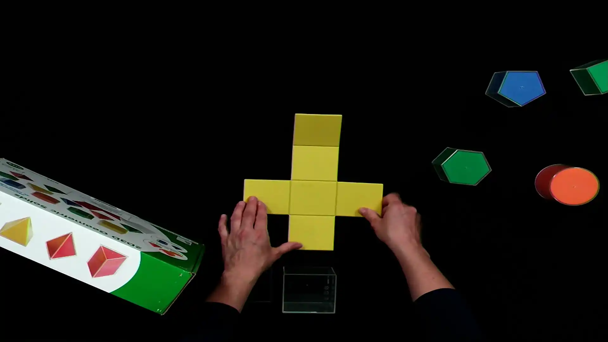

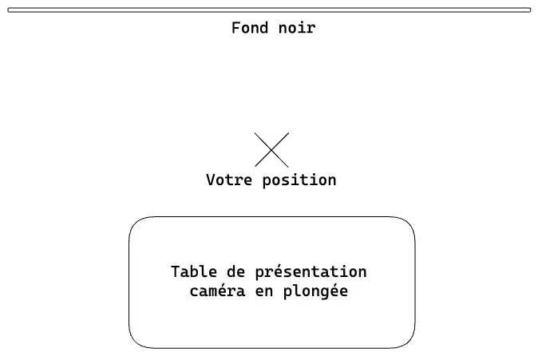
:::
:::::

---

## Bon à savoir {#bon-a-savoir}

Utiliser la télécommande de la caméra pour obtenir les cadrages de caméra désirés.

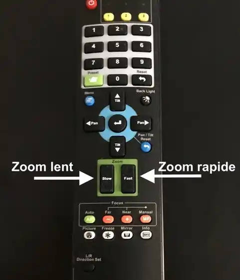

Utilisez les boutons de la télécommande pour la **caméra du haut**.

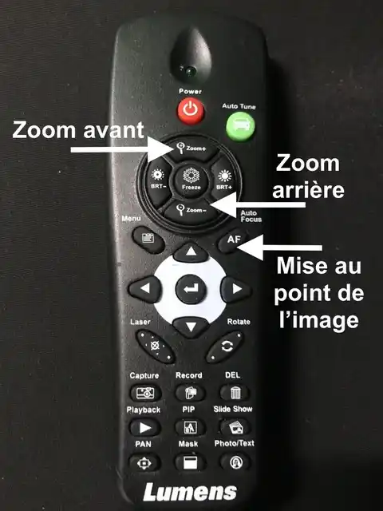

- Un câble HDMI relié à l'écran mobile est mis à votre disposition pour diffuser des images.
- Des fiches murales permettent de transférer des fichiers vers l’ordinateur.
- Le port de vêtements clairs est conseillé.
- Bien étirer le rideau noir pour assurer un fond uniforme.

---

## Avant de quitter

Replacer tout mobilier utilisé au cours de la session.

---

## Édition {#edition}

[Des postes d'édition](/medias/postes-edition) sont mis à votre disposition avec une suite de logiciels pour faire du montage.
