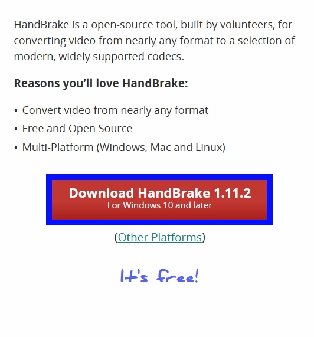
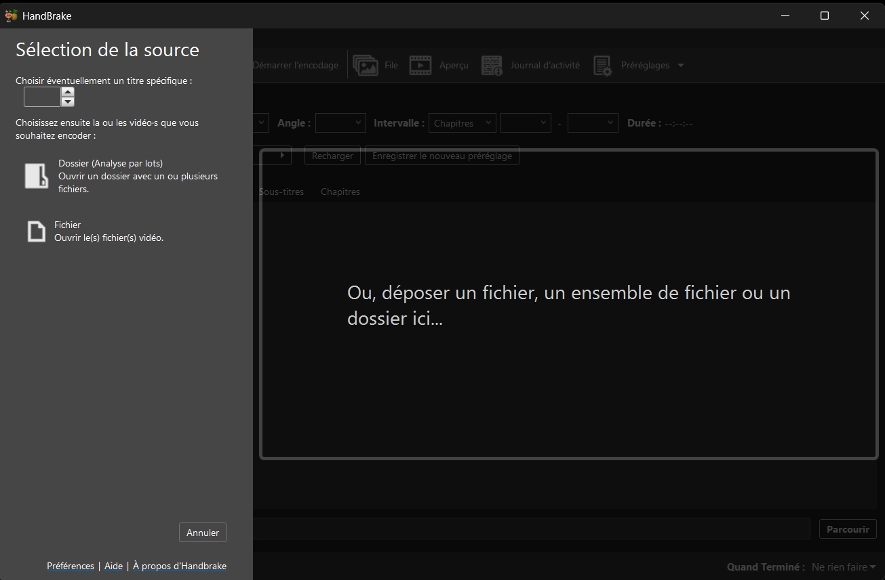
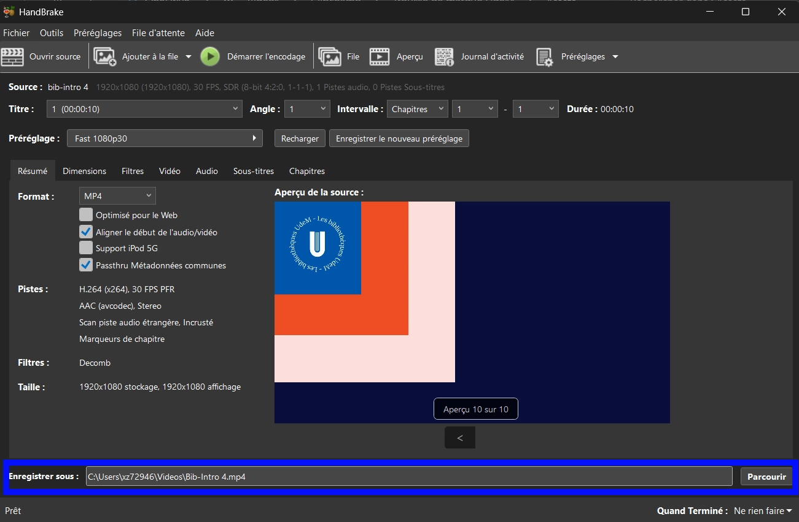
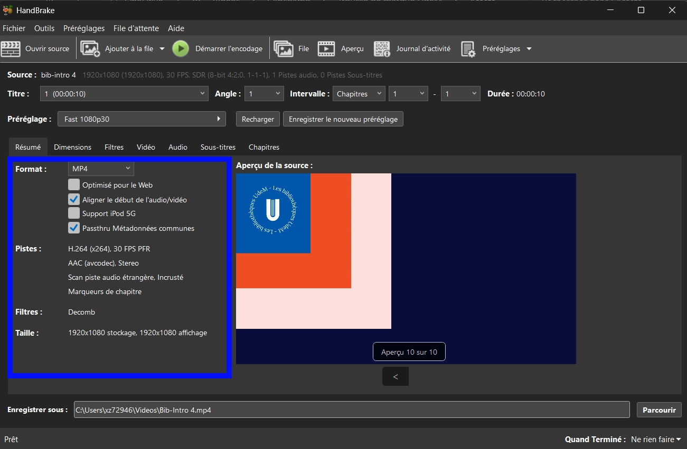
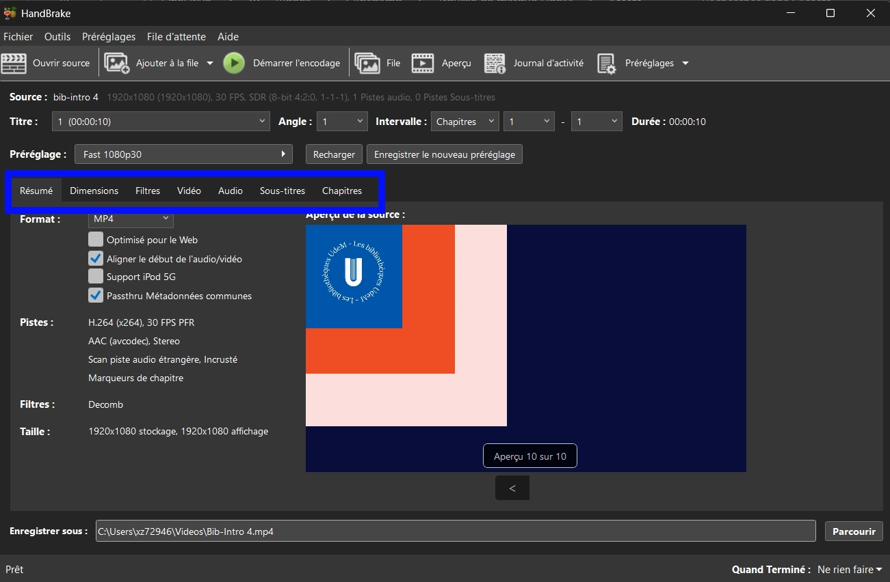
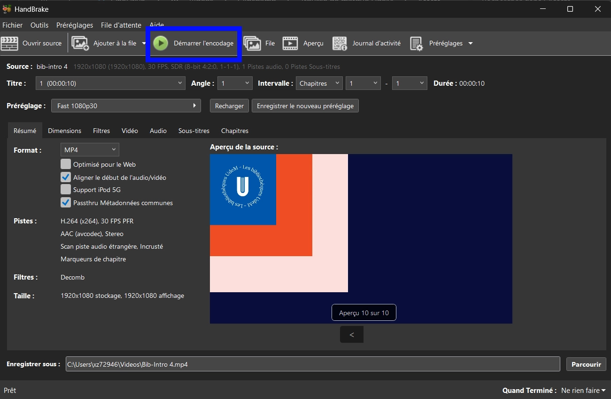

Ce guide explique comment installer et utiliser HandBrake pour réencoder des vidéos du H.265 au H.264.

## Introduction

Certains ordinateurs ont de la difficulté à ouvrir les fichiers encodés en H.265. Il existe un moyen très simple de réencoder votre vidéo en H.264 : HandBrake.

## Installation

### 1) Télécharger le logiciel

- Aller à [l’adresse suivante](https://handbrake.fr/) pour télécharger le logiciel, disponible pour Windows, Mac et Linux.
- Cliquer sur le bouton rouge de téléchargement.

### 2) Installer le logiciel

- Exécuter le fichier que vous venez de télécharger afin de lancer l’installation.
- Une fois le logiciel installé, le lancer.

## Utilisation

- Une fois lancé, le logiciel ressemble à ceci :

- Les points clés pour passer du H.265 au H.264 :

::::onglets
:::onglet[Déposer]{valeur="A"}
### Déposer le ou les fichiers

Glisser et déposer le ou les fichiers à réencoder à l’endroit prévu à cet effet.

:::

:::onglet[Enregistrer]{valeur="B"}
### Enregistrer

Vérifier que le fichier final sera enregistré à l’endroit souhaité.

:::

:::onglet[Paramètres]{valeur="C"}
### Paramètres

Vérifier que les paramètres appliqués sont ceux souhaités.

:::

:::onglet[Onglets]{valeur="D"}
### Onglets de personnalisation des paramètres

Au besoin, modifier ce qu’il faut dans les différents onglets.

:::

:::onglet[Encoder]{valeur="E"}
### Démarrer l’encodage

Cliquer sur **Démarrer l’encodage**.

:::

::::

Le fichier final se retrouve dans le dossier choisi.
