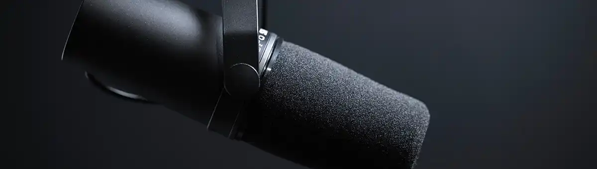
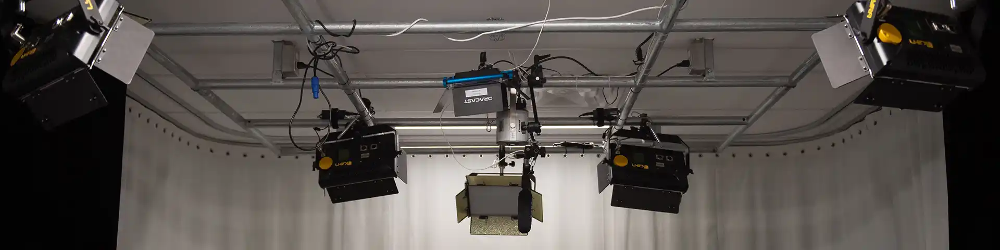
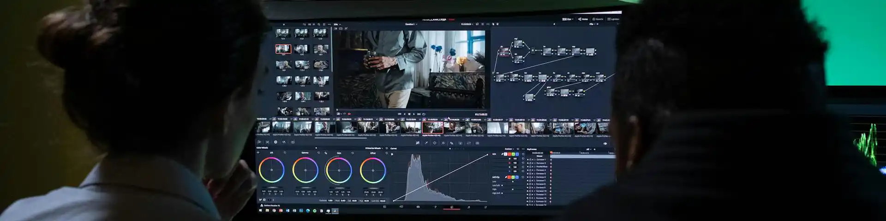

Les bibliothèques de l'Université de Montréal offrent des studios, des postes d'édition et des guides d'utilisation pour réaliser vos productions audio, vidéo et graphiques.

:::cartes
-  [Studios balado](/espaces/studiosbalado) Espaces équipés pour l’enregistrement de balados audio et vidéo.
-  [Studios vidéo](/espaces/studiosvideo) Espaces équipés pour la captation vidéo de projets audiovisuels.
-  [Postes d'édition](/medias/postes-edition) Ordinateurs équipés pour le montage audio, vidéo et l'infographie. Accessibles avec ou sans réservation.
:::

## Production audio

:::cartes
- :icone[book-open-text] [Guide baladodiffusion](/medias/balado) Étapes et outils pour créer un balado de l'enregistrement jusqu'à la diffusion.
- :icone[waveform] [Guide balado vidéo](/medias/guidebaladovideo) Guide d'utilisation du studio de balado vidéo
- :icone[waveform] [RODECaster Pro II](/medias/rodecaster) Guide d'utilisation de la console audio RØDECaster pour l'enregistrement.
- :icone[file-audio] [Audacity](/medias/audacity) Introduction à l'enregistrement et au montage audio avec le logiciel libre Audacity.
:::

## Production vidéo {#production-video}

:::cartes
- :icone[book-open-text] [Guide du studio vidéo LSH](/medias/guidevideolsh) Guide d'utilisation du studio vidéo LSH
- :icone[book-open-text] [Guide du studio vidéo TGD](/medias/guidevideotgd) Guide d'utilisation du studio vidéo TGD
- :icone[record] [OBS](/medias/obs) Utiliser OBS Studio pour enregistrer, streamer ou capter du contenu vidéo.
- :icone[monitor-play] [Téléprompteur](/medias/teleprompteur) Utilisation du téléprompteur du studio vidéo pour afficher du texte ou du contenu devant la caméra.
- :icone[book-open-text] [HandBreak](/medias/handbreak) Guide d'utilisation pour réencoder une vidéo avec HandBreak
:::

## Infographie

:::cartes
- :icone[pencil-simple-line] [Guide d'utilisation de la tablette graphique Kamvas 13](/medias/tabgraphique) Connexion, installation et premiers pas avec la tablette Huion Kamvas 13.
:::
