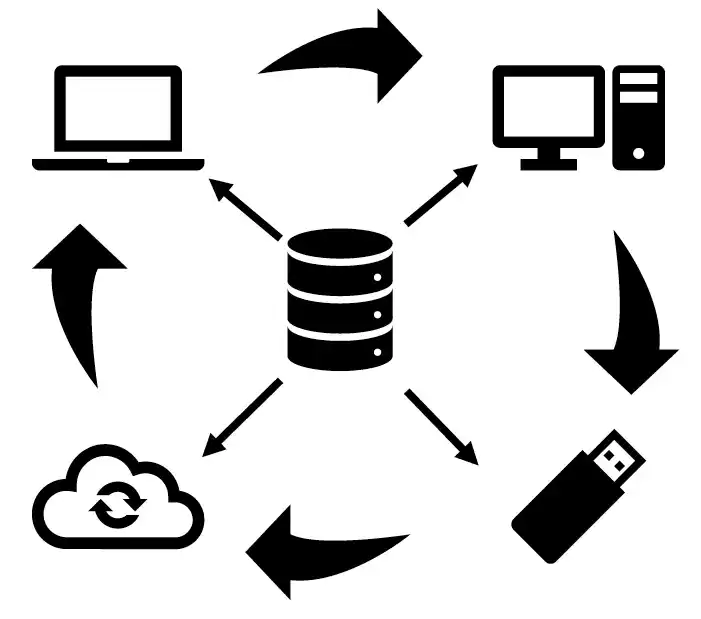

---

:::alerte{type="succes" titre="À propos de cette documentation"}
Cette page a été rédigée à partir d’un guide produit par le [Laboratoire multimédia (LaM)](https://fas.umontreal.ca/laboratoires/lam/) de la Faculté des arts et des sciences, avec quelques adaptations et ajouts propres au contexte des bibliothèques de l’UdeM.
:::

---

## Introduction

DaVinci Resolve est un logiciel de **montage, mixage audio, composition et étalonnage** développé par Blackmagic Design.\
Originellement conçu pour l’étalonnage, il s’est diversifié depuis 2014 pour inclure toutes les étapes de production.

Deux versions existent :

- **Studio (payante)** avec plus de fonctionnalités.
- **Gratuite**

**Configuration minimale recommandée** : 16 Go RAM et 2 Go VRAM.\
Même si Resolve fonctionne en dessous, cela ralentit le rendu et l’exportation.

Téléchargement : [Blackmagic Design - DaVinci Resolve](https://www.blackmagicdesign.com/products/davinciresolve/)

La version gratuite est installé sur les [postes d'édition](/medias/postes-edition) des bibliothèques UdeM et au [Laboratoire multimédia](https://fas.umontreal.ca/laboratoires/lam/) (LaM) au pavillon Marie-Victorin.

La version complète **DaVinci Resolve Studio** est disponible uniquement [dans le poste d'édition de la Bibliothèque des lettres et sciences humaines](https://bib.umontreal.ca/espaces/#lsh) (BLSH).

---

## Avant-propos

- Installez la version **française** de Resolve pour suivre plus facilement cette documentation, même si celle-ci contient quelques passages non traduits.
- Le changement de langue se fait dans **Barre de menus** → **DaVinci Resolve** → **Préférences** → **Utilisateur** → **Interface** → **Langue**

:::alerte{type="attention" titre="Un redémarrage est nécessaire après changement de langue."}
:::

---

## Chapitre 1. Préparer vos périphériques de sauvegarde

Aujourd’hui, la quasi-totalité du travail audiovisuel se fait sur ordinateur. Cela facilite la création, mais rend aussi vos projets plus vulnérables : un fichier peut disparaître en un clic, être écrasé ou corrompu sans laisser de trace.

Pour éviter de perdre plusieurs heures de tournage, il est essentiel d’organiser vos sauvegardes. Que vous utilisiez un disque dur externe, interne, une clé USB ou une carte SD, vos supports doivent être choisis et gérés avec soin.

Dans ce chapitre, nous allons nous concentrer sur les **disques durs**, car les fichiers audiovisuels sont souvent volumineux. Les clés USB et cartes SD peuvent dépanner, mais elles sont rarement adaptées à une gestion fiable à long terme. Un disque dur de bonne capacité est donc le support recommandé pour stocker et sécuriser vos projets au fil des années.

### Disque dur personnel

Dépendant de l’utilisation qu’on en fait, les disques durs peuvent être classés dans deux groupes :

- **Disque dur de travail** : SSD recommandé (500 Go à 1 To). Rapide, robuste, mobile.
- **Disques de sauvegarde** : plus volumineux (2–4 To), moins chers, pour archiver vos projets.

### Disque dur des postes de l'Université

- Toujours transférer votre projet sur **votre disque de travail** après usage dans un des postes d'édition de l'Université.
- Les fichiers laissés sur un poste peuvent disparaître lors d’une maintenance.
- Alternative : un espace infonuagique comme Dropbox/Google Drive, mais cette manipulation peut être longue.

### Format du disque dur

- Pour une meilleure compatibilité Mac/Windows : **exFAT** recommandé.
- macOS : **Utilitaire de disque** → **Sélectionner le disque branché** → **Effacer**.
- Windows : **Explorateur** → **Ce PC** → **Sélectionner le disque branché** → **Clic droit** → **Formater**.

:::alerte{type="attention" titre="Le formatage supprime toutes les données. Sauvegardez avant!"}
:::

### La règle des trois copies

Pour sécuriser vos données, conservez-les toujours à **3 endroits différents**.\
Exemples :

- Ordinateur de bureau + portable + disque externe.
- Ordinateur portable + disque externe + service infonuagique.

---

## Chapitre 2. L’interface de DaVinci Resolve

DaVinci Resolve s’ouvre en deux étapes :

::image-interactive{nom="resolve-interface"}

---

### Le gestionnaire de projet

Le gestionnaire de projet centralise tous vos projets, même s’ils sont enregistrés à différents emplacements.\
Par défaut, un projet « Untitled Project » est créé. Cette fenêtre disparaît dès qu’un projet est ouvert, mais vous pouvez la rouvrir en cliquant sur l’icône **maison** en bas à droite de l’interface.

La fenêtre se divise en deux panneaux :

1. **Bases de données** : affiche les emplacements de vos bases. Si le panneau est masqué, cliquez sur l’icône à gauche de *Projets*.
2. **Projets** : liste les projets associés à la base sélectionnée.

- Pour localiser une base, faites un clic droit → **Afficher dans le Finder** (macOS).
- Pour créer un nouveau projet, cliquez sur **Nouveau projet** ou ouvrez le projet par défaut.

:::alerte{type="attention"}
Un fichier projet (.drp) est très léger car il **ne contient pas les médias**.\
Si vos fichiers changent d’emplacement, Resolve les marquera **hors ligne**.\
Il est donc essentiel de garder vos médias au même endroit que lors de la création du projet.
:::

---

### Les pages de travail

Une fois un projet ouvert, Resolve affiche la page **Cut** par défaut.\
L’interface peut sembler complexe, mais elle suit une même logique :

- deux barres de navigation communes à toutes les pages ;
- des panneaux principaux visibles dès l’ouverture ;
- des panneaux secondaires que vous pouvez afficher ou masquer selon vos besoins.

#### Les barres de navigation

- **Barre des panneaux secondaires** : permet d’ouvrir ou fermer différents panneaux selon vos besoins.
- **Barre des pages** : en bas de l’écran, elle permet de passer d’une page de travail à une autre.
- **Icône engrenage** : ouvre les paramètres du projet.
- **Icône maison** : rouvre le gestionnaire de projet.

:::alerte{type="succes" titre="Astuce"}
Avec deux écrans, activez le mode **double écran** :

**Espace de travail → Double écran → On**

Certains panneaux seront déplacés sur le second écran.\
Si vous venez de brancher l’écran, un redémarrage du logiciel peut être nécessaire.
:::

### Les pages disponibles

Chaque page est un environnement spécialisé, mais elles sont interconnectées : une modification faite dans l’une est répercutée dans toutes les autres.

::image-interactive{nom="resolve-barre-pages"}

---

## Chapitre 3. Gérer vos données personnelles

Resolve stocke les projets dans des **bases de données**.\
Deux types existent :

- **base de données locale (*local database*)** : par défaut, créée à l’installation du logiciel et sauvegardée par défaut sur le disque dur interne de l’ordinateur.
- **base de données externe (*external database*)** : recommandée, créée par l’utilisateur à l’emplacement de son choix (Par exemple son disque dur externe). Permet de transporter ses projets, ses préférences utilisateur et ses préférences système d’un ordinateur à l’autre sans perdre de données en ne cloisonnant pas son travail à un seul poste de travail.

:::alerte{type="attention"}
Ne laissez jamais vos projets uniquement sur les ordinateurs de l'Université. Les profils utilisateurs sont régulièrement effacés.
:::

### Créer une base de données externe

1. Sur votre disque dur, créez un dossier nommé `resolve_nomdedisque`. En règle générale, il faut éviter les espaces et les accents en nommant ses dossiers et fichiers, qui sont des caractères entrant en conflit avec certaines structures informatiques.
2. Dans Resolve → **Gestionnaire de projet** → **Nouvelle base de données**.
3. Sélectionnez le dossier et validez.
4. La base apparaît maintenant dans la liste des bases connectées.

:::alerte{type="attention"}
Les projets exportés (.drp) sont légers car ils **ne contiennent pas les médias**.\
Vous devez toujours conserver vos fichiers originaux.
:::

### Connecter une base de données externe

Si c’est la première fois que vous travaillez à un poste, vous devez connecter votre base de données externe en indiquant à Resolve où votre base de données est sauvegardée :

1. Dans le **Gestionnaire de projet**, cliquer sur **Connecter une base de données**.
2. Sélectionner le dossier contenant la base.
3. lui donner un nom (il peut être différent de celui d’origine) puis cliquer sur **Connecter**.
4. Elle sera ajoutée et accessible comme une base locale.

### Exporter / importer un projet (.drp)

Si vous ne souhaitez pas travailler depuis une base de données mobile, vous pouvez exporter votre projet en drp et l’importer dans la base de données locale de l’ordinateur quand vous désirez travailler :

- **Exporter** : clic droit sur un projet → **Exporter le projet**.
- **Importer** : clic droit dans l’espace projets → **Importer un projet**.

:::alerte{type="succes" titre="Astuce"}
Utilisez l’export en .drp comme sauvegarde rapide (clé USB, espace infonuagique), mais pensez toujours à garder vos **médias liés**.
:::

## Chapitre 4. Créer un nouveau projet

### Démarrer un nouveau projet

1. Dans le **Gestionnaire de projet** : clic droit → **Nouveau projet**.
2. Donnez un nom clair (par exemple : le sigle du cours ou le sujet du projet).
3. Par défaut, la page **Cut** (montage rapide) s’ouvre automatiquement.

### Définir les paramètres du projet

Les paramètres d’un projet détermineront le format de votre travail, entre autres la résolution et le nombre d’images par seconde pour nommer les plus connus. Ces paramètres sont automatiquement appliqués par défaut à l’ensemble de vos timelines.

1. Menu : **Fichier** → **Paramètres du projet…**.
2. Les réglages importants sont :

- A : **Résolution de la timeline** (ex. : 1920×1080 pour du Full HD).
- B : **Fréquence d’images** (24, 25 ou 30 fps selon vos sources).

3. Cliquer sur **Enregistrer** pour que les changements soient conservés.

:::alerte{type="attention"}
Choisissez la bonne fréquence d’images **avant d’importer vos médias**.\
Un mauvais réglage peut entraîner des problèmes de fluidité.
:::

#### Enregistrer un préréglage

- Une fois vos paramètres définis, enregistrez-les comme **préréglage**.
- Vous pourrez ainsi les réutiliser dans vos futurs projets sans tout reconfigurer.

### Gérer les espaces caches

- Par défaut, Resolve crée ses fichiers **caches** et **optimisés** sur l’ordinateur local, ce qui permet une fluidité du travail.
- Pour améliorer la fluidité et garder vos projets portables :
  - Redirigez ces caches vers votre disque de travail externe (préférable).
  - Vérifiez ce paramètre dans les **Préférences système**.
    - 1. **Fichier** → **paramètres du projet**.
    - 2. la section **Dossiers de travail** de l’onglet **Configuration du projet** permet de modifier l’emplacement pour la génération du proxy, des fichiers caches et des images de référence de la galerie. En cliquant sur parcourir, vous pouvez indiquer à Resolve de générer ces fichiers temporaires dans un espace de votre disque dur externe, que vous appellerez **cache**.
    - 3. Cliquez sur **Enregistrer** pour appliquer les changements.

### Ouvrir plusieurs projets simultanément

Il est possible que vous souhaitiez visionner deux projets à la fois et pouvoir transitionner rapidement de l’un à l’autre. Il est également possible de copier des éléments d’un projet à l’autre, ce qui peut s’avérer utile si vous souhaitez recycler une section de montage d’un autre projet.

Pour activer la fonction :

1. Dans le **gestionnaire de projets**, clic droit → **navigation dynamique entre les projets**.
2. En ouvrant un second projet, vous remarquerez qu’une nouvelle flèche est maintenant disponible à droite du nom de votre projet, en haut de la fenêtre des espaces de travail, qui permet de naviguer entre les projets présentement ouverts.
3. Le crochet rouge (A) indique le projet actuellement visible dans la fenêtre de travail, alors que le ou les crochets blancs (B) indiquent tous les autres projets actuellement ouverts.

:::alerte{type="succes" titre="Astuce"}
Certaines manipulations sont bloquées lorsqu’un projet est ouvert, comme la possibilité de supprimer un projet. Si vous avez l’option **navigation dynamique** d’active, il faut s’assurer qu’un projet soit fermé pour, par exemple, le supprimer.
:::

## Chapitre 5. La gestion des médias

L’étape de gestion des médias est cruciale : vos fichiers vidéo, audio et images doivent être importés et organisés correctement pour un projet fluide et stable.

- Les panneaux principaux :

1. **Moniteur source** : aperçu des fichiers.
2. **Bibliothèque de médias** : organisation de vos chutiers.

- Les panneaux secondaires :

3. **Espaces de stockage** : dossiers accessibles depuis l’ordinateur.
4. **Audio** : gestion des pistes sonores.
5. **Métadonnées** : informations détaillées sur chaque fichier.

### Ajouter des dossiers

1. Clic droit → **Ajouter un nouvel emplacement**.
2. Clic droit sur le dossier, puis choisir l’option **ajouter le dossier et les sous-dossiers à la bibliothèque de médias** (**Créer des chutiers**).
3. Resolve peut demander d’ajuster automatiquement les paramètres du projet si les médias importés ne correspondent pas aux paramètres actuels.
4. Créez de nouveaux **chutiers** (`⇧⌘N`) pour classer vos fichiers par catégories (ex. : *vidéo*, *audio*, *images*).

### Médias hors ligne

- Si un fichier est déplacé, Resolve le perd et il devient **hors ligne**.
- Icône signalée par un **maillon rouge** dans la timeline.
- Pour le relier :
  - `Menu > Recherche > Sélectionner dossier racine`.

💡 **Astuce**\
Si le média a changé de nom ou de format : clic droit sur le plan → **Remplacer le plan sélectionné**.

### Organisation recommandée

- Préparez vos dossiers avant d’importer :
  - `Projet > Vidéos brutes`
  - `Projet > Audio`
  - `Projet > Images`
- Gardez la même arborescence sur disque et dans Resolve pour éviter la confusion.

:::alerte{type="succes"}
Une bonne organisation au départ vous évitera des dizaines d’heures perdues plus tard.\
Nommez clairement vos fichiers et vos chutiers !
:::

## Chapitre 6. Le montage

Le montage est au cœur de DaVinci Resolve. C’est ici que vous assemblez vos plans, audio et images pour créer un récit fluide.

### Les outils de navigation

- **Barre de défilement** : permet d’avancer ou reculer dans la timeline.
- **Raccourcis utiles** :
  - `Espace` : lecture / pause.
  - `I` : point d’entrée.
  - `O` : point de sortie.
  - `Maj + Z` : ajuster le zoom de la timeline.
- **Zoom** : utilisez la molette ou la barre en bas de la timeline pour ajuster la vue.

### Les pistes

- **Vidéo (V1, V2, …)** : superposer vos plans.
- **Audio (A1, A2, …)** : voix, musiques, bruitages.
- Vous pouvez verrouiller (`icône cadenas`) ou rendre muet une piste.

### Montage de base

- **Glisser-déposer** vos fichiers depuis le chutier vers la timeline.
- **Couper** :
  - `B` pour activer la lame de rasoir.
  - Cliquez pour couper un plan.
  - `A` pour revenir à l’outil de sélection.
- **Supprimer une portion** : sélectionnez et appuyez sur `Suppr`.

### Les types de montage

- **Insertion** : insère un plan à l’endroit du curseur.
- **Écrasement** : remplace un plan déjà présent.
- **Montage par glisser** : déplace un plan sans casser la continuité.

### Travailler avec le magnétisme

- Le bouton **Aimant** active/désactive l’alignement automatique des clips.
- Très utile pour éviter des espaces vides.

💡 **Astuce**\
Pensez à utiliser les **chutiers** pour organiser vos plans avant de les déposer sur la timeline.

### Raccourcis essentiels pour le montage

- `Cmd + B` : couper au curseur.
- `Shift + Cmd + Z` : zoom timeline complet.
- `Cmd + Z` : annuler.
- `Cmd + ⇧ + Z` : rétablir.

:::alerte{type="info"}
Le montage demande de l’organisation : sauvegardez régulièrement et utilisez des noms clairs pour vos séquences.
:::

## Chapitre 7. Navigation et édition avancée

Une fois à l’aise avec les bases du montage, DaVinci Resolve propose des outils plus précis pour affiner vos séquences.

### La navigation dans la timeline

- **Curseur de lecture** : se déplace manuellement ou via les touches `←` et `→` (image par image).
- `Maj + ← / →` : navigation par incréments plus larges.
- `Haut / Bas` : aller au début ou à la fin des plans.

💡 **Astuce**\
Vous pouvez placer plusieurs **marqueurs** (`M`) pour repérer vos moments clés.

### Outils d’édition avancée

- **Trim dynamique** : permet d’ajuster la fin d’un plan tout en déplaçant les suivants.
- **Rouleau** : modifie simultanément la fin d’un plan et le début du suivant.
- **Glissement** : conserve la durée d’un plan mais change sa portion utilisée.
- **Répousser** : décale un plan tout en déplaçant les suivants.

👉 Ces outils s’activent dans la barre au-dessus de la timeline ou par clic droit sur un clip.

### Les transitions

- Dans l’onglet **Effets** → **Transitions vidéo**.
- Glissez-déposez une transition entre deux plans.
- Durée ajustable en tirant sur ses extrémités.

⚠️ **Attention**\
Les transitions exigent un recouvrement des plans (handles).\
Si vos plans sont trop courts, la transition risque d’être impossible.

### La synchronisation audio/vidéo

- Importez vos vidéos et fichiers audio séparés.
- Sélectionnez-les > clic droit > **Synchroniser les clips**.
- Resolve utilise la forme d’onde audio pour aligner automatiquement.

💡 **Astuce**\
Si l’auto-synchro échoue, vous pouvez aligner manuellement via l’onglet **Forme d’onde audio** dans la timeline.

### Les effets simples

- **Correction de vitesse** : clic droit > **Changer la vitesse**.
- **Image figée** : clic droit > **Créer une image fixe**.
- **Stabilisation** : disponible dans l’onglet **Étalonnage** (paramètres du plan).

### Raccourcis utiles pour l’édition avancée

- `Cmd + T` : ajouter une transition par défaut.
- `Alt + Glisser` : dupliquer un plan.
- `Cmd + R` : activer/désactiver le contrôle de vitesse.

:::alerte{type="info"}
Ces fonctions avancées permettent d’économiser un temps précieux en montage professionnel.
:::

## Chapitre 8. Le son avec Fairlight

Fairlight est l’espace de travail de DaVinci Resolve dédié au **traitement et au mixage audio**.\
C’est un environnement complet, comparable à un logiciel de montage sonore professionnel.

### Interface Fairlight

- Pistes audio avec formes d’onde.
- Console de mixage (volume, panoramique, égalisation, effets).
- Possibilité d’ajouter des bus (mixage de plusieurs pistes vers une sortie commune).

### Nettoyer et améliorer le son

- **Réduction de bruit** : supprimer les sons parasites (souffle, ventilation).
- **Égalisation (EQ)** : renforcer ou atténuer certaines fréquences (ex. : grave, aigu).
- **Compresseur** : homogénéiser le volume entre les passages faibles et forts.

⚠️ **Attention**\
Évitez les réglages trop extrêmes : un son trop compressé ou filtré fatigue l’écoute.

### Ajouter des effets audio

- Onglet **Effets** → effets natifs (reverb, delay, EQ, etc.).
- Glisser-déposer sur une piste ou un clip audio.
- Paramétrer via la fenêtre de réglages.

💡 **Astuce**\
Pour une voix plus claire :

- Couper les basses en dessous de 80 Hz.
- Ajouter un léger boost entre 3–5 kHz.

### Automatiser le volume

- Activez l’**enregistrement d’automation**.
- Déplacez les curseurs en temps réel pour créer des variations (fondu en entrée/sortie).
- Utile pour équilibrer voix, musique et bruitages.

### Raccourcis utiles en Fairlight

- `A` : outil de sélection.
- `B` : outil lame (découpe).
- `M` : ajouter un marqueur.
- `Cmd + ,` : ouvrir les préférences Fairlight.

:::alerte{type="succes"}
Pensez toujours au confort d’écoute. Un bon mixage se reconnaît quand l’auditeur n’a pas besoin de monter ou baisser le volume.
:::

## Chapitre 9. L’étalonnage (Color)

L’étalonnage est une étape essentielle pour donner une **cohérence visuelle** et une identité esthétique à votre projet.\
DaVinci Resolve est d’ailleurs reconnu mondialement pour la puissance de son module Color.

### Interface de l’espace Color

- **Timeline en bas** : vos plans avec vignettes.
- **Viewer** : affiche le résultat en temps réel.
- **Panneaux de correction** : roues colorimétriques, courbes, barres de réglages.
- **Nœuds** : chaque correction s’applique sous forme de “nœud” dans un graphe.

👉 Chaque nœud représente une étape de traitement. Vous pouvez enchaîner plusieurs nœuds pour mieux organiser vos corrections (ex. : un pour l’exposition, un pour la balance des blancs, un pour l’effet créatif).

### Les outils principaux

- **Lift (noirs)**, **Gamma (tons moyens)**, **Gain (hautes lumières)** : permettent de corriger la luminosité et la couleur.
- **Offset** : ajuste globalement toute l’image.
- **Courbes** : corrections plus fines par canal (RVB).
- **Qualificateur** : isole une couleur spécifique pour la modifier.
- **Power Windows** : zones de masquage (par ex. éclaircir seulement un visage).

💡 **Astuce**\
Travaillez toujours dans cet ordre :

1. **Balance des blancs** (neutraliser dominantes de couleur).
2. **Contraste et exposition**.
3. **Saturation**.
4. Ajustements créatifs (look, ambiance).

### Les scopes (analyse visuelle)

Resolve propose plusieurs outils pour évaluer objectivement votre image :

- **Waveform** : luminance de gauche à droite.
- **Vectorscope** : intensité et direction des couleurs.
- **Parade RGB** : équilibre des trois canaux couleur.
- **Histogramme** : répartition des niveaux d’intensité.

⚠️ **Attention**\
Ne vous fiez pas uniquement à vos yeux : les écrans des ordinateurs peuvent être mal calibrés. Les **scopes** assurent une correction précise.

### Trucs pratiques

- Dupliquez vos nœuds pour tester différentes approches.
- Utilisez des **groupes** pour appliquer la même correction à plusieurs plans.
- Sauvegardez vos looks en **LUTs** pour réutilisation.

:::alerte{type="succes"}
Un bon étalonnage ne doit pas se remarquer : l’objectif est d’harmoniser les images et de renforcer la narration visuelle.
:::

## Chapitre 10. Exportation

Une fois le montage terminé, il faut générer un fichier vidéo final.\
Dans Resolve, cette étape se fait dans la page **Deliver (Exportation)**.

### Paramètres d’exportation de base

- **Nom du fichier** : clair et unique (ex. : projet_cours_date.mp4).
- **Destination** : disque externe ou dossier bien identifié.
- **Format le plus courant** : MP4 (H.264).
- **Qualité** : Élevée, mais attention à la taille de fichier.

👉 Pour un rendu destiné au web (YouTube, Vimeo) :

- Résolution : 1920×1080 (ou 1280×720).
- Codec : H.264.
- Framerate : identique au projet.
- Audio : AAC, 48 kHz.

### Exportation YouTube/Vimeo

Resolve propose des préréglages :

- **YouTube** (1080p ou 4K).
- **Vimeo**.
- Ils configurent automatiquement le format recommandé par les plateformes.

💡 **Astuce**\
Vous pouvez connecter directement votre compte YouTube et publier sans quitter Resolve.\
Mais il est souvent plus sûr d’exporter d’abord le fichier, puis de l’envoyer manuellement.

### Exportation pour diffusion locale

- Choisir **QuickTime** (MOV) ou **MP4**.
- Codec **DNxHD** ou **ProRes** pour un rendu de qualité (mais plus lourd).
- Idéal si vous voulez retravailler ensuite dans un autre logiciel.

### La file d’attente de rendu

- Cliquez sur **Ajouter à la file de rendu** pour préparer plusieurs exports d’un coup.
- Lancez ensuite le rendu de toute la file.
- Vous pouvez ainsi générer plusieurs versions : par ex. une version légère web + une version haute qualité.

⚠️ **Attention**\
Toujours vérifier l’**emplacement du fichier exporté** avant de lancer le rendu, pour éviter de le perdre dans un dossier par défaut.

### Raccourcis utiles

- `Cmd + /` : basculer rapidement sur la page Deliver.
- `Espace` : lancer un aperçu du rendu.

:::alerte{type="info"}
Mieux vaut faire un **test d’exportation de quelques secondes** avant de lancer le rendu complet, surtout pour un long projet.
:::

## Chapitre 11. Raccourcis clavier essentiels

Maîtriser les raccourcis clavier dans DaVinci Resolve permet de **gagner énormément de temps** au montage.\
Voici une sélection des plus utiles :

### Navigation

- `Espace` : lecture/pause.
- `← / →` : avancer/reculer image par image.
- `↑ / ↓` : passer au plan précédent/suivant.
- `Maj + ← / →` : navigation rapide.

### Montage

- `B` : outil **lame** (cut).
- `A` : outil **sélection**.
- `Cmd + Z` : annuler.
- `Cmd + Maj + Z` : rétablir.
- `Cmd + C / V` : copier/coller.
- `Suppr` : supprimer un clip (laisser un trou).
- `Maj + Suppr` : suppression en **ripple** (efface et recolle automatiquement).

### Timeline

- `N` : activer/désactiver l’**aimant** (snap).
- `Cmd + =` : zoom avant.
- `Cmd + -` : zoom arrière.
- `Alt + roulette souris` : zoom horizontal dans la timeline.

### Audio

- `Cmd + ,` : préférences Fairlight.
- `M` : ajouter un marqueur.
- `Alt + Glisser` : dupliquer un clip audio.

### Exportation

- `Cmd + /` : passer à la page Deliver (Export).
- `Cmd + E` : exporter rapidement (selon dernier réglage).

💡 **Astuce**\
Vous pouvez personnaliser les raccourcis :\
`DaVinci Resolve > Clavier personnalisé`\
Cela permet d’adapter Resolve à vos habitudes (ex. : si vous venez de Premiere ou Final Cut).

:::alerte{type="succes"}
Apprenez progressivement les raccourcis : commencez par les plus fréquents (lecture, cut, supprimer) et ajoutez-en d’autres au fur et à mesure.
:::

## Chapitre 12. Conseils pratiques & conclusion

Monter avec DaVinci Resolve demande un peu d’apprentissage, mais les bases s’acquièrent rapidement.\
Voici quelques recommandations finales pour travailler efficacement.

### Conseils généraux

- **Organisez vos fichiers** avant d’importer (dossier Vidéo, Audio, Images).
- **Nommez clairement vos projets et chutiers** pour éviter de vous perdre.
- **Sauvegardez souvent** : Resolve peut planter, comme tout logiciel de montage.
- **Travaillez sur un disque externe rapide** pour gagner en fluidité.

### Bonnes pratiques de montage

- Coupez **au service de l’histoire**, pas seulement de l’esthétique.
- Privilégiez des coupes franches plutôt que des transitions excessives.
- Équilibrez vos niveaux audio : la voix doit rester claire et constante.
- Harmonisez vos couleurs et évitez les variations trop visibles entre plans.

### Pour aller plus loin

- Explorez **Fusion** pour les effets visuels avancés.
- Testez **les LUTs créatives** pour donner un style particulier à vos vidéos.
- Utilisez **les projets collaboratifs** (Studio) pour travailler en équipe.

💡 **Astuce**\
La pratique régulière est la meilleure manière de progresser. Montez de petits projets (clips, exercices, capsules) pour développer vos réflexes.

---

## Conclusion

Avec DaVinci Resolve, vous avez entre les mains un outil **professionnel complet** qui couvre toutes les étapes :

- Importation et organisation.
- Montage vidéo.
- Traitement audio.
- Étalonnage.
- Exportation.

Même en utilisant seulement les fonctions de base, vous pouvez réaliser des projets de qualité professionnelle.\
La clé est de rester organisé, patient et créatif.

:::alerte{type="succes"}
Votre meilleur allié : la curiosité. Explorez les menus, testez les options, regardez des tutoriels, et surtout… pratiquez !
:::
