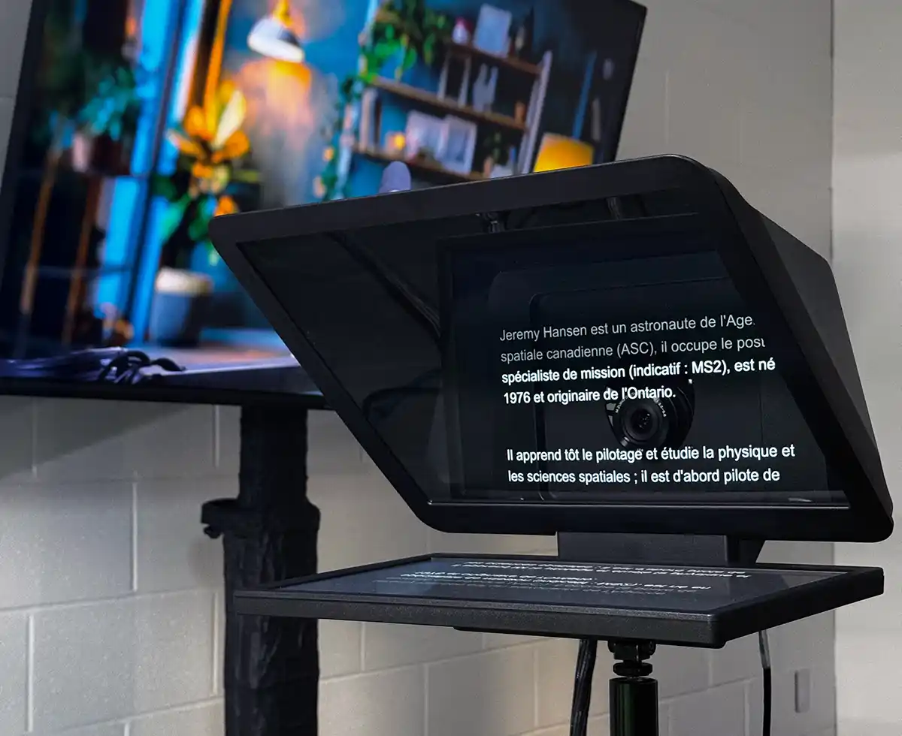

Le téléprompteur permet d’afficher du texte ou du contenu devant l’objectif de la caméra, afin de le consulter tout en gardant le regard dirigé vers la caméra.

:::alerte{type="info"}
Le téléprompteur est disponible uniquement dans le [Studio vidéo](/espaces/studiovideolsh) de la Bibliothèque des lettres et sciences humaines (BLSH).
:::

## Utilisation

### Se connecter au poste

Se connecter au PC du studio avec ses identifiants UdeM. Le logiciel **Camera Hub** se lance automatiquement et permet de contrôler le téléprompteur.

### Afficher un texte

- Dans **Camera Hub**, sélectionner le mode **Texte**, puis copier ou saisir le texte à afficher.
- Ajuster la taille du texte et son affichage à l’écran.

Pour plus de confort pendant l’enregistrement, il est recommandé de contrôler le défilement du texte à l’aide du contrôleur placé dans le studio.

[Les boutons du contrôleur](#contrôleur-du-téléprompteur) permettent de faire avancer ou reculer le texte au rythme souhaité, sans interrompre l’enregistrement.

**Camera Hub** permet également d’activer le défilement automatique et d’en régler la vitesse. Cette option peut être utile pour un texte continu, mais nécessite d’adapter le rythme de lecture à celui du téléprompteur.

:::alerte{type="info" titre="Conseil"}
Faire un essai avant l’enregistrement afin d’ajuster la taille du texte et de se familiariser avec les commandes du contrôleur.
:::

### Afficher une présentation ou un autre contenu

Le téléprompteur peut également être utilisé comme un deuxième écran, permettant d’y afficher :

- une présentation PowerPoint;
- un document PDF;
- une image;
- une page Web;
- toute autre fenêtre ouverte sur le PC du studio.

1. [Appuyer sur le **bouton 1** du contrôleur](#contrôleur-du-téléprompteur) pour changer le mode d’affichage du téléprompteur et l’utiliser comme deuxième écran. (voir en bas)

2. Ouvrir le contenu souhaité sur le PC du studio, puis déplacer simplement la fenêtre vers l’écran du téléprompteur.

Pour une présentation PowerPoint, il est possible d’afficher les diapositives directement devant la caméra.

### Contrôleur du téléprompteur

Le contrôleur permet de contrôler le texte affiché sur le téléprompteur pendant un enregistrement.

:::telecommande[Prompteur]
- :icone[copy] **Changer d'affichage** : permet de basculer entre l'affichage **texte** dans **Camera Hub** vers l'affichage **écran**.
- (touche non utilisée)
- :icone[arrow-up] **Défiler vers le haut** : fait défiler manuellement le texte vers le haut.
- :icone[skip-back] **Section précédente** : revient à la section précédente du texte dans le prompteur.
- :icone[skip-forward] **Section suivante** : passe à la section suivante du texte dans le prompteur.
- :icone[arrow-down] **Défiler vers le bas** : fait défiler manuellement le texte vers le bas.
:::
